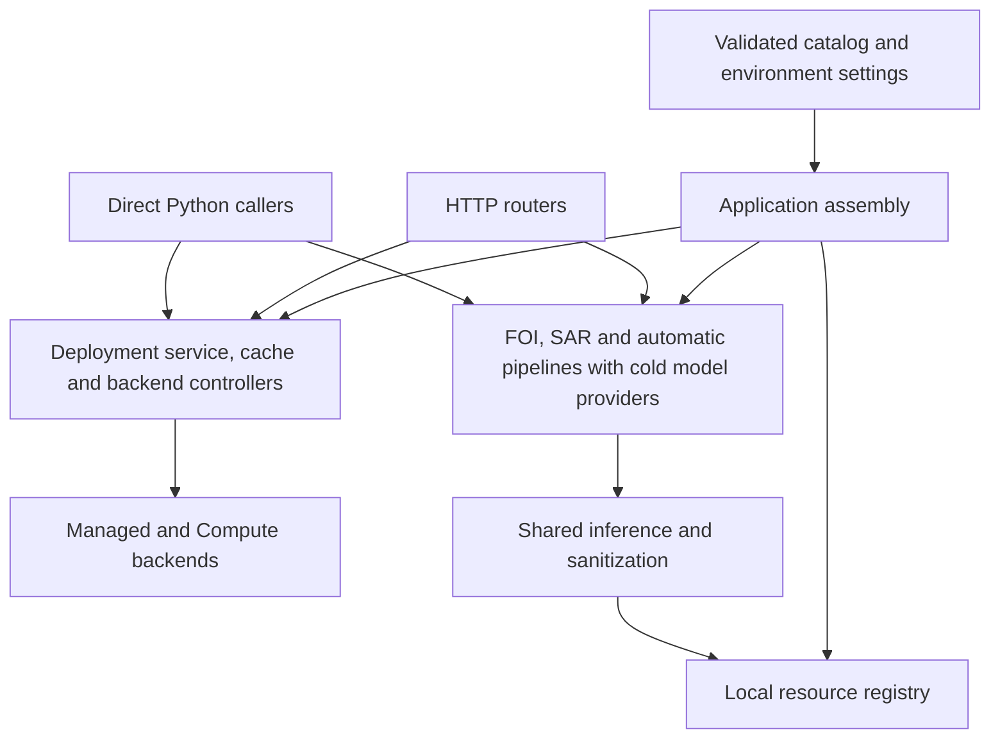

# Application architecture

The application has two entry points: a FastAPI server and a deployment-management
CLI. Feature pipelines can also be called directly from Python. Configuration
describes resources; application assembly gives their runtime objects an owner.

## Where to start reading

| Question | Starting point |
| --- | --- |
| How are dependencies connected? | [bootstrap.py](../src/llm_management/bootstrap.py) |
| How is the API constructed? | [server.py](../src/llm_management/server.py) and [api/](../src/llm_management/api/) |
| How does startup, warm-up or scaling work? | [deployments/service.py](../src/llm_management/deployments/service.py) |
| Where do configuration and cloud operations belong? | [deployments/config.py](../src/llm_management/deployments/config.py), [catalog.py](../src/llm_management/deployments/catalog.py), [managed.py](../src/llm_management/deployments/managed.py) and [compute.py](../src/llm_management/deployments/compute.py) |
| How are local models protected and unloaded? | [inference/resources.py](../src/llm_management/inference/resources.py) |
| How is an FOI request processed? | [foi/pipeline.py](../src/llm_management/foi/pipeline.py) |
| Where are classifier decisions made? | [sar/pipeline.py](../src/llm_management/sar/pipeline.py) and [automatic/pipeline.py](../src/llm_management/automatic/pipeline.py) |
| How do sanitization guarantees work? | [sanitization/contracts.py](../src/llm_management/sanitization/contracts.py), [presidio.py](../src/llm_management/sanitization/presidio.py) and [foi/sanitization.py](../src/llm_management/foi/sanitization.py) |
| How are reusable VM images prepared? | [templates/](../src/llm_management/templates/) and [the template guide](../EXOSCALE_TEMPLATES.md) |

## Ownership and dependency direction



`DeploymentCatalog.load()` and `get_catalog()` validate configuration without
registering models, loading weights or constructing cloud backends.
`assemble_application()` creates the deployment service and registers cold
factories. Each factory constructs a controller on first use. Model weights load
only during inference or explicit warm-up.

An application owns its deployment cache, activity context, backend controllers,
local-resource registry and automatic-classifier admission capacity. Warm-up and
inference resolve the same local controller. Idle unloading clears its weights;
the retained controller can load them again. Separate assemblies have independent
guards and caches, even when resource slugs match.

Public convenience calls outside an API app use one process-local default
assembly. Standalone model-controller constructors use a private guard unless
given a registry. Pass explicit application dependencies when processing batches
or testing independent configurations.

The service coordinates locks, activity, startup cancellation, warm-up, scaling and
shutdown. Managed and Compute backends implement the same lifecycle interface;
their validated configuration objects perform no cloud operations. Compute state
is constructed only when its backend is needed. Template preparation remains a
separate subsystem.

HTTP modules own request schemas, authentication and error translation. Feature
pipelines and the deployment service do not import FastAPI. Domain decisions stay
with their features: SAR retains its flag on failure, while automatic detection
returns an unresolved classification. Shared inference code handles execution,
leases and probability validation.

## Follow an inference request

1. `api/` validates the request and calls a feature pipeline with the application's
   service and model providers.
2. FOI segments the original text, sanitizes related fields with one mapping,
   classifies sanitized contextual inputs, and reconstructs both original and
   sanitized questions from the same predictions.
3. When remote work is required, `DeploymentService` ensures the deployment and
   tracks its activity. The selected backend performs the cloud operations.
4. Model owners hold local leases in their worker threads for loading and inference.
   Caller cancellation cannot release a model while its worker still uses it.
5. The feature validates output and returns its own result schema. HTTP error
   translation occurs at the API boundary.

Original FOI text remains in public extraction results. Sanitized text is used for
model inputs. `Sanitized[T]` records an immutable policy attestation; it does not
claim detection is exhaustive. FOI field-selection adapters depend on the small
`TextSanitizer` protocol, rather than Presidio's implementation details.

The Python names `ReconstructedQuestion` and `ResponseContextQuestion` distinguish
request extraction from questions supplied to response analysis. Established
`ExtractedQuestion` wire schema names remain unchanged. `models.py` is a small
compatibility import facade; new code imports configuration, errors and state
from their owning deployment modules. The SAR logistic compatibility import also
delegates to the shared predictor.

## Direct Python use

The same assembly used by HTTP callers can be supplied to the FOI pipeline:

```python
from llm_management.bootstrap import assemble_application
from llm_management.deployments.types import DeploymentAccess
from llm_management.foi.pipeline import process_information_request


async def process_one(text: str):
    application = assemble_application()
    service = application.deployments
    deployments = DeploymentAccess(
        service.get_config, service.ensure_running, service.cache.touch
    )
    try:
        with service.track_requests():
            return await process_information_request(
                text, deployments=deployments, resources=application.foi
            )
    finally:
        await service.close()
```

Reuse one assembly for an entire batch rather than constructing it per item.
`application.sar.detect(text, fast=True)` and
`application.automatic.detect(body, fast=True)` use the same local owners as
`application.deployments.warmup_resource(slug)`. Closing the service unloads idle
local resources and scales down remote deployments used by that application.
See [the FOI guide](foi.md) for HTTP batch examples.

## Adding or changing code

### Add a feature pipeline

Keep its decision policy and results in the feature package. Supply the model and
deployment operations it needs explicitly. Expose HTTP contracts through a router
under `api/`, connected in `server.py`. Extend the application assembly when the
feature needs shared resource ownership. Keep package `__init__.py` files limited
to deliberate public exports.

Test decisions directly with injected predictors, then test HTTP validation and
error/result mapping separately. Avoid a generic cascade framework: features can
share probability validation and execution while retaining different policies.

### Add a local resource loader

Add a validated catalog loader schema and its references in
`deployments/catalog.py`. Implement the controller in the feature's resources
module, or in shared inference code when it is reusable. Give its load and unload
callbacks a `LocalResource` guard. Register its cold factory in `bootstrap.py` and
bind a provider into the relevant feature dependencies.

Constructors may establish a guard but must not download weights. Loading and
inference run in worker threads under a lease. Unloading clears all owned model
references. Test warm-up, inference, expiry and reload through the same owner, and
verify that fast or negative paths do not load unused models.

### Add a deployment backend

Define validated configuration under `deployments/config.py`. Implement
`DeploymentBackend` from `deployments/backends.py` and add its explicit selector.
Keep cloud operations out of catalog validation and config properties. The service
owns one backend controller per slug and supplies the cache with status results.

Test startup, cancellation, request leases, idle cleanup and backend-specific
capabilities such as replica limits. Use fake cloud clients for the local suite;
mark tests that create or contact real deployments as external.

## Validation and test navigation

Tests remain under `tests/`, named after the boundary they exercise:

- `test_bootstrap.py` and `test_local_resources.py`: cold registration, ownership,
  independent assemblies, leases and unloading.
- `test_deployment_service.py`, `test_deployment_groups.py` and
  `test_scaling_endpoints.py`: lifecycle orchestration and HTTP management contracts.
- `test_compute_deployments.py` and template tests: cloud operations using fake
  clients and CLI dispatch.
- Classifier tests: policies, loading, score validation, overload and cancellation.
- FOI tests: pure segmentation/reconstruction, pipeline sequencing, prompts,
  sanitization, transport validation and HTTP contracts.

Run focused tests for the changed boundary, then use the integration gate:

```sh
poetry run pytest -m 'not external' -q
poetry run ruff check .
poetry run ruff format --check .
git diff --check
```

Model smoke tests do not establish classifier accuracy. Response-analysis schemas
and validation are implemented, but its inference adapter currently returns 501.
The [shared GPU/LoRA design](proposals/shared-gpu-serving.md) is a proposal; it is
not an additional implemented FOI backend.
