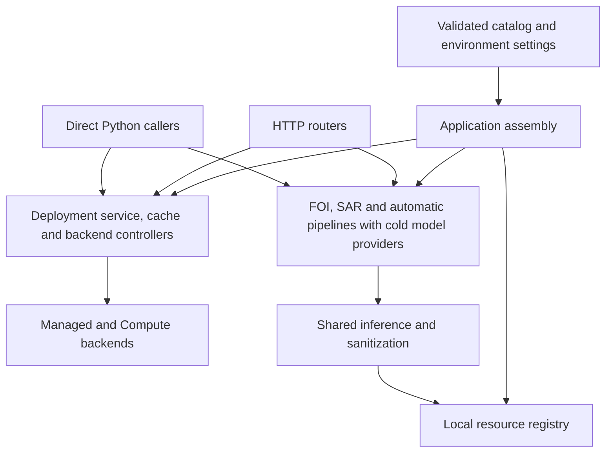

# Application architecture

The application has two entry points: a FastAPI server and a deployment-management
CLI. Feature pipelines can also be called directly from Python. Configuration
describes resources; application assembly gives their runtime objects an owner.

## Where to start reading

| Question | Starting point |
| --- | --- |
| How are dependencies connected? | [bootstrap.py](../src/llm_management/bootstrap.py) |
| How is the API constructed? | [server.py](../src/llm_management/server.py) and [api/](../src/llm_management/api/) |
| How does startup, warm-up or scaling work? | [deployments/service.py](../src/llm_management/deployments/service.py) |
| Where do configuration and cloud operations belong? | [deployments/config.py](../src/llm_management/deployments/config.py), [catalog.py](../src/llm_management/deployments/catalog.py), [managed.py](../src/llm_management/deployments/managed.py) and [compute.py](../src/llm_management/deployments/compute.py) |
| How do resource types fit together, and how do I add one? | [Resource registration guide](resource-registration.md) |
| How are local models protected and unloaded? | [inference/resources.py](../src/llm_management/inference/resources.py) |
| How is an FOI request processed? | [foi/pipeline.py](../src/llm_management/foi/pipeline.py) |
| Where are classifier decisions made? | [sar/pipeline.py](../src/llm_management/sar/pipeline.py) and [automatic/pipeline.py](../src/llm_management/automatic/pipeline.py) |
| How do sanitization guarantees work? | [sanitization/contracts.py](../src/llm_management/sanitization/contracts.py), [presidio.py](../src/llm_management/sanitization/presidio.py) and [foi/sanitization.py](../src/llm_management/foi/sanitization.py) |
| How are reusable VM images prepared? | [templates/](../src/llm_management/templates/) and [the template guide](../EXOSCALE_TEMPLATES.md) |

## Ownership and dependency direction



`DeploymentCatalog.load()` and `get_catalog()` validate configuration without
registering models, loading weights or constructing cloud backends.
`assemble_runtime()` creates the deployment service and registers cold
factories. Each factory constructs a controller on first use. Model weights load
only during inference or explicit warm-up.

Catalog schemas validate each configuration entry. The named checks in
[`catalog_validation.py`](../src/llm_management/deployments/catalog_validation.py)
validate relationships between entries: deployment namespaces, checkpoint references,
warm-up group membership and feature bindings. These checks use configuration types
only. A new resource type needs a feature-binding check only when its feature imposes
additional constraints, such as two resources sharing a checkpoint.

`ApplicationRuntime` owns services, resources and their lifecycle; `app` is the
FastAPI HTTP interface hosting that runtime. The runtime also serves direct batch
callers without FastAPI. It is a plain typed container. Its constructor retains injected
dependencies by identity; it does not parse configuration, build a Pydantic schema
or start tasks. Configuration validation belongs to `DeploymentCatalog`.
Entering `async with runtime` starts idle cleanup. Closing stops that loop,
drains SAR and automatic classifier work, then releases deployment resources.
Concurrent closes share one cleanup task, and cancellation waits for cleanup before
propagating. Each runtime has its own lifecycle; a closed instance cannot restart.

HTTP routers are module-level objects. The single FastAPI dependency in
`api/__init__.py` retrieves the typed runtime from
`request.app.state.runtime`. Routes accept `DependencyRuntime` and select
its service or feature owner directly, without constructing resources per request.
Feature functions still receive their specific dependencies explicitly. Tests can
override `get_runtime` to substitute the complete runtime.
`create_app(runtime=...)` requires an existing runtime and delegates lifespan to
its context manager. It configures HTTP routes and middleware; it does not assemble
services. The server entry point uses `app = create_app(runtime=assemble_runtime())`.
Separate FastAPI apps can use the same routes with independent runtimes.

An application owns its deployment status cache, activity tracker, backend controllers,
local-resource registry and automatic-classifier admission capacity. Warm-up and
inference resolve the same local controller. Idle unloading clears its weights;
the retained controller can load them again. Separate assemblies have independent
guards and caches, even when resource slugs match.

Here, an **owner** is the ordinary Python model controller, such as
`CategoryMatcher`. It holds configuration and, once loaded, the encoder, tokenizer
and category index; it also implements `predict()`, `load()` and `unload()`. Creating
the owner does not itself load those model objects.

Its **guard** is the `LocalResource` available as `matcher.resource`. The guard
holds load/unload callbacks, tracks readiness and recent activity, and coordinates
access. A **lease** is the duration of a `with resource.use():` block: idle cleanup
must skip that resource while the block is active. The model controller holds the
loaded state; the guard protects its use.

A **provider** is a zero-argument function that returns the controller when needed.
`ResourceProviders` retains controllers for feature inference; `ResourceRegistry`
retains their guards for warm-up, status and unloading. Both refer to the same
resource. Tokenizer factories are a smaller variant: their callbacks hold cached
state, and the returned `LocalResource` itself serves as the provider's owner.

HTTP startup, batch entry points and test fixtures assemble their runtime.
Feature functions receive the specific resources, providers or deployment client
they need; they never look up a process-wide runtime. Batch callers use
`async with assemble_runtime() as runtime` to own startup and shutdown.
Tests can instead supply small provider or sanitizer doubles for isolated behaviour.

The service coordinates locks, activity, startup cancellation, warm-up, scaling and
shutdown. Managed and Compute backends implement the same lifecycle interface;
their validated configuration objects perform no cloud operations. Compute state
is constructed only when its backend is needed. Template preparation remains a
separate subsystem.

HTTP modules own request schemas, authentication and error translation. Feature
pipelines and the deployment service do not import FastAPI. Domain decisions stay
with their features: SAR retains its flag on failure, while automatic detection
returns an unresolved classification. Shared inference code handles execution,
leases and probability validation.

## Follow an inference request

1. `api/` validates the request and calls a feature pipeline with the application's
   service and model providers.
2. FOI segments the original text, sanitizes related fields with one mapping,
   classifies sanitized contextual inputs, and reconstructs both original and
   sanitized questions from the same predictions.
3. When remote work is required, the feature enters `deployments.use(slug)` for
   startup and a lease covering inference. The selected backend performs cloud
   operations; the lease protects the deployment until the feature leaves the block.
4. Model owners hold local leases in their worker threads for loading and inference.
   Caller cancellation cannot release a model while its worker still uses it.
5. The feature validates output and returns its own result schema. HTTP error
   translation occurs at the API boundary.

Original FOI text remains in public extraction results. Sanitized text is used for
model inputs. `Sanitized[T]` records an immutable policy attestation; it does not
claim detection is exhaustive. FOI field-selection adapters depend on the small
`TextSanitizer` protocol, rather than Presidio's implementation details.

The Python names `ReconstructedQuestion` and `ResponseContextQuestion` distinguish
request extraction from questions supplied to response analysis. Established
`ExtractedQuestion` wire schema names remain unchanged. `models.py` is a small
compatibility import facade; new code imports configuration, errors and state
from their owning deployment modules. The SAR logistic compatibility import also
delegates to the shared predictor.

## Direct Python use

The same assembly used by HTTP callers can be supplied to the FOI pipeline:

```python
from llm_management.bootstrap import assemble_runtime
from llm_management.foi.pipeline import process_information_request


async def process_one(text: str):
    async with assemble_runtime() as runtime:
        return await process_information_request(
            text,
            deployments=runtime.deployments,
            resources=runtime.foi,
        )
```

Reuse one assembly for an entire batch rather than constructing it per item.
`runtime.sar.detect(text, fast=True)` and
`runtime.automatic.detect(body, fast=True)` use the same local owners as
`runtime.deployments.warmup_resource(slug)`. Exiting the runtime context stops idle cleanup,
drains classifier work, then unloads inactive local resources and scales down remote
deployments used by that runtime. HTTP lifespan uses this same context manager.
For manually managed lifetimes, call `await runtime.close()`; repeated calls
share one shutdown operation, and cleanup finishes before cancellation propagates.
A runtime lifetime is single-use; assemble another runtime after shutdown.

`assemble_deployments()` creates just the service and typed local providers.
`assemble_service()` returns its service without constructing feature pipelines.
Management-only callers own the service's idle task and shutdown explicitly.
`service.management` exposes `warm_up`, `stop`, `cool_down`, `status`, `overview`
and `local_status` for both HTTP and direct callers. This layer interprets group
addresses and returns the HTTP-compatible result models; the service executes
operations under the existing resource leases and deployment locks. Group actions
share resolution and concurrent execution while retaining their own failure
contracts and configured result order.
See [the FOI guide](foi.md) for HTTP batch examples.

## Classifier task lifetime

SAR and automatic classification each own a `ClassifierTasks[Result]` instance
from [inference/tasks.py](../src/llm_management/inference/tasks.py). It checks the
configured pending limit before creating work, retains accepted tasks, and supplies
a shielded result future. Cancelling an HTTP or batch caller does not cancel its
worker or release admission early. Automatic classification still owns its separate
concurrency semaphore; tasks waiting for that semaphore count towards admission.
Model weights remain protected by their existing resource guards.

Each feature submits its logistic operation and handles the returned result or
exception itself. SAR retains its moderation flag on inference failure; automatic
classification returns its unresolved result. Encoder batching and the decision to
run it remain explicit in each pipeline. The task owner has no knowledge of these
policies or model providers.

Shutdown first stops new gate admission, then closes encoder batching and drains
accepted gates. Late positive gates encounter the closed encoder queue and receive
the feature's existing unavailable result. Gate draining still runs if encoder
cleanup fails, and cancellation of the drain waits for accepted work to finish.
A closed task owner cannot be reused; create a new application for a new lifetime.

## Adding or changing code

### Add a feature pipeline

Keep its decision policy and results in the feature package. Supply the model and
deployment operations it needs explicitly. Expose HTTP contracts through a router
under `api/`, connected in `server.py`. Extend the application assembly when the
feature needs shared resource ownership. Keep package `__init__.py` files limited
to deliberate public exports.

Test decisions directly with injected predictors, then test HTTP validation and
error/result mapping separately. Avoid a generic cascade framework: features can
share probability validation and execution while retaining different policies.

### Add or reuse a resource type

Use the [resource registration guide](resource-registration.md) to choose between
an existing local resource type, a new local loader, a remote deployment, or a
hosted API model. It maps the current resource families, explains type versus
instance versus feature role, and gives the declaration and integration steps.

Local registrations are ordinary named values in `deployments/resource_types.py`.
Each associates a schema with a lazy factory/owner binding. The catalog schema
and application factory lookup derive from these declarations; feature policy
stays explicit in the owning feature.

### Add a deployment backend

Define validated configuration under `deployments/config.py`. Implement
`DeploymentBackend` from `deployments/backends.py` and add its explicit selector.
Keep cloud operations out of catalog validation and config properties. The service
owns one backend controller per slug and supplies the cache with status results.

Test startup, cancellation, request leases, idle cleanup and backend-specific
capabilities such as replica limits. Use fake cloud clients for the local suite;
mark tests that create or contact real deployments as external.

## Validation and test navigation

Tests remain under `tests/`, named after the boundary they exercise:

- `test_bootstrap.py` and `test_local_resources.py`: cold registration, ownership,
  independent assemblies, leases and unloading.
- `test_deployment_service.py`, `test_deployment_groups.py` and
  `test_scaling_endpoints.py`: lifecycle orchestration and HTTP management contracts.
- `test_compute_deployments.py` and template tests: cloud operations using fake
  clients and CLI dispatch.
- Classifier tests: policies, loading, score validation, overload and cancellation.
- FOI tests: pure segmentation/reconstruction, pipeline sequencing, prompts,
  sanitization, transport validation and HTTP contracts.

Run focused tests for the changed boundary, then use the integration gate:

```sh
poetry run pytest -m 'not external' -q
poetry run ruff check .
poetry run ruff format --check .
git diff --check
```

Model smoke tests do not establish classifier accuracy. Response analysis uses the
pinned v4 status prompt and tokenizer with validated, bounded remote generation;
the checkpoint remains an integration candidate requiring independent evaluation.
The [shared GPU/LoRA design](proposals/shared-gpu-serving.md) is a proposal; it is
not an additional implemented FOI backend.


## Remote inference lifetime

Use `async with service.use(slug) as running` around the actual remote operation.
The context ensures startup, acquires a lease under the deployment's lifecycle
lock, and releases that lease on success, failure or cancellation. Nested and
concurrent uses have independent leases. Idle cleanup, cool-down and explicit
scale-to-zero check those leases before acting. The idle countdown restarts when
inference finishes. HTTP middleware is no longer needed for deployment leases.

Feature pipelines accept the `DeploymentInference` protocol: `get_config(slug)`
and `use(slug)`. Pass `runtime.deployments` directly; the service implements
this protocol, so features need only these two operations. Input preparation, checkpoint
checks, output validation and error translation remain in each feature. Test clients
can implement just these two operations.

Inference uses `use()` to acquire and release its lease explicitly. Management uses
`prepare()` to start or resize a deployment without holding an inference lease.
Both operations share startup locking and cancellation handling. Feature test doubles
implement `get_config()` and an asynchronous `use()` context manager directly.

Assembly creates `DeploymentStatusCache` and `DeploymentActivityTracker` separately
and passes both to the service. The status cache contains only `DeploymentSnapshot`
records: observed cloud state and connection details. The tracker owns idle times,
lease counts and startup/scaling locks. Preparation, management and cleanup read
status snapshots directly. A slow cloud refresh cannot overwrite a live lease,
and status eviction does not remove activity.

Status and activity are separate records throughout the runtime. Seeding or
refreshing status cannot replace live activity. Management owns single-resource and
group command interpretation, typed outcomes and ordered group results; the service
owns execution, locks, leases and shutdown. HTTP state stores only the runtime.

### Response-analysis dependencies

`analyze_response()` requires `resources` and `deployments` from its caller.
An optional sanitizer overrides the resource container's sanitizer. The internal
`predict()` operation also requires explicit dependencies and retains the
sanitized-input check, checkpoint validation, remote lease and output validation.

### Catalog collections

Remote and local deployments, API model/search deployments and deployment groups
are stored in typed dictionaries keyed by slug. Lookup methods retain their typed
results and useful missing-entry errors. Iterate `.values()` to visit entries in
configuration order; a group's member slugs remain an ordered list.

The configuration boundary accepts the existing TOML arrays and validates every
entry before building a dictionary, rejecting duplicate slugs. Keyed input is also
accepted, provided each key matches its entry's slug. Catalog exports retain the
existing array format, so configuration round trips do not change file structure.
There is no second cached index to synchronize. Slug fields are immutable after
construction: to rename an entry, create its replacement under the new key and
revalidate the catalog, including feature and group references.
