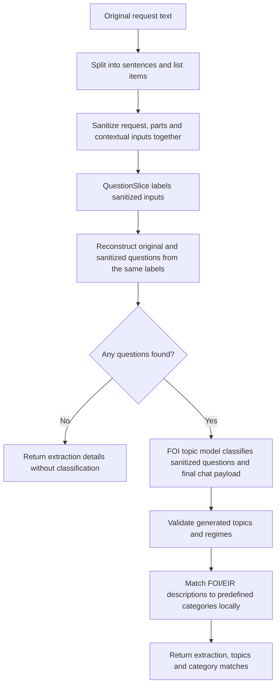

# How the information-request pipeline works

`POST /endpoint/foi/extract_questions` takes an FOI request and returns a structured
set of questions with FOI/EIR/SAR status, short descriptions and predefined category
matches. Relevant deployment
group: `group_foi_pipeline_cpu` for the default `backend=cpu`, or
`group_foi_pipeline` for `backend=exoscale`.

`POST /endpoint/foi/extract_questions/extract` returns just the question structure,
primarily for internal debugging. It omits status and topic classification. The
same groups can warm it, though they also warm the full classification pipeline.

Correspondence-analysis model inputs first pass through local CPU Presidio sanitization. The public-authority email finder described below uses a separate external API policy. Extraction results retain original text; see the [sanitization policy and CPU lifecycle](sanitization.md).

Two fine-tuned models do different jobs: **QuestionSlice finds the questions** and **FOI topic model classifies them**. QuestionSlice is built on ModernBERT; FOI topic model is built on Granite. We use these task-specific names throughout this guide; `foi_topic` is the corresponding deployment name in configuration. A “question” can be an instruction such as “Please provide the report”; it does not need a question mark.



## Which fine-tuned models are used?

The model names below are Hugging Face repository IDs. They identify the trained files to load. The Exoscale deployment names are shorter names used by this application to find or start a remote instance.

| Job | Model repository | Exoscale deployment |
|---|---|---|
| Find and group requests for information | `mySociety/question-slice-modernbert-2026-09-08-1` | `question_slice` (when using GPU extraction) |
| Assign access regimes and topics | `mySociety/foi-topic-1b-2026-09-16-1` | `foi_topic` |
| Analyze response status | `mySociety/foi-status-3b-2026-10-12-1` | `foi_status` |

**QuestionSlice** is the fine-tuned ModernBERT classifier trained to assign the four labels described below. CPU and Exoscale extraction use this same checkpoint: CPU runs the whole model, while Exoscale runs its encoder and the API runs its original classification layer. The default local model/tokenizer revision is `eb0436d4be96f113f35b5f891f9cc876a0f0bd6b`. These long revision IDs identify specific versions of the model files.

**FOI topic model**, the merged fine-tuned Granite model, contains both the original model and the changes learned during fine-tuning. It was created from the base model `ibm-granite/granite-4.0-1b` (revision `6a7381ba1f54d684ff508d991aeb7dc580157103`) and the LoRA adapter `mySociety/granite-tiny-foi-topic-grounded-v2` (revision `200b756850c137c255f2e6c5c24474edd894d010`). The merged checkpoint is now published as `mySociety/foi-topic-1b-2026-09-16-1`, the repository used for inference.

Keep the remote import and local model/tokenizer versions aligned when updating either model. For that reason, Exoscale extraction returns `extraction_revision: null` rather than claiming a verified remote revision.

[deployments/catalog.py](../src/llm_management/deployments/catalog.py) defines the typed deployment catalog. [deployments.toml](../conf/deployments.toml) stores shared checkpoint identities, pinned local revisions, local and remote deployments, pipeline bindings, and model limits. [settings.py](../src/llm_management/settings.py) supplies credentials and host environment settings. The `v2` and `grounded-v2` strings are parts of the trained model names, not separate API versions.

## 1. Split the request into manageable parts

[question_slice.py](../src/llm_management/foi/question_slice.py) joins wrapped lines where appropriate, keeps list items together, and splits ordinary prose into sentences. Each part gets a numbered position, starting at zero, so we can record where a question came from.

Before inference, the request, parts and contextual windows are sanitized with one shared placeholder mapping. Original parts remain available for the public result. For each part, we show QuestionSlice the sanitized previous part, current part and next part. This gives it context without asking it to process the whole letter at once. The formatting follows what the model saw during training.

This step returns a `list[SemanticUnit]`. Each `SemanticUnit` contains the part’s `index`, its `text`, and a `kind` of `sentence` or `list_item`. These are positions in the split request, not character offsets.

## 2. Decide what each part is doing

QuestionSlice assigns one of four labels:

| Label | Meaning |
|---|---|
| `QUESTION_START` | Starts a new request for information |
| `QUESTION_CONTINUATION` | Continues an earlier request |
| `ADDITIONAL` | Supporting text kept separately from the questions |
| `IGNORE` | Text left out of the questions, such as a greeting |

We keep the model's probabilities and chosen label. The returned `confidence` is the probability of that label, not a calibrated guarantee that it is correct. List items are classified too: a contextual bullet need not become a question, and several items can be grouped into one question.

[backends.py](../src/llm_management/foi/backends.py) controls where this work happens:

- **CPU**, the default: the whole QuestionSlice model runs in the API process.
- **Exoscale**: the main part of QuestionSlice runs on a remote GPU. It returns numeric representations of the text, and the model's small final classification layer runs locally to produce the labels. This split is needed because the managed gateway exposes embeddings rather than a classification endpoint.

The `backend` choice affects extraction only. FOI topic model runs on Exoscale in both cases.

The label decisions are represented as a `list[UnitPrediction]`. Each `UnitPrediction` contains the original `SemanticUnit`, the chosen `UnitLabel`, its `confidence`, and the probabilities for all four labels. The backend initially returns numeric probability rows; the extraction code validates these and builds the Pydantic objects.

## 3. Assemble the questions

Each start opens a new question; continuations join the most recent question. We build question text from the selected parts and assign IDs such as `q1` and `q2`. We also return additional text and ignored text. Source-part membership is used during reconstruction but is not returned with each question.

There is one recovery rule for this dataset: **if there are no question starts anywhere, but there is a continuation, treat the first continuation as a start**. This can recover a request that the model recognised but labelled incorrectly. It can also combine separate asks, so it is a heuristic rather than a certainty.

If a start exists elsewhere, a continuation before it remains unresolved. The result is marked `uncertain`. If neither starts nor continuations exist, the result is `no_questions_found` and FOI topic model is skipped. Otherwise the result is `questions_found`.

The original labels remain in the response, even after recovery. `promoted_continuation_index` records which part was promoted. Orphan-continuation positions are used internally to determine the extraction status, but are not returned.

The extraction stage returns a `QuestionSliceResult`, which is also the response from `/endpoint/foi/extract_questions/extract`. Its `questions` field is a list of `ReconstructedQuestion` objects (`ExtractedQuestion` in the established wire schema): each has a `question_id` and reconstructed `text`. The result also includes the extraction status, raw `UnitPrediction` objects, additional/ignored text, recovery details and extraction model information.

## 4. Classify the extracted questions with FOI topic model

[topic_classification.py](../src/llm_management/foi/topic_classification.py) sends the sanitized request and reconstructed sanitized questions to the merged, fine-tuned FOI topic model checkpoint. Its training adapter is already incorporated into the model; no separate adapter is loaded during a request.

For each question, FOI topic model returns:

- An access regime: `FOI` (Freedom of Information), `EIR` (Environmental Information Regulations), or `SAR` (subject access to personal data).
- A short topic describing the subject of the question.

For example, “Please provide the latest air pollution monitoring report” might
receive `EIR` and a topic such as “Air pollution monitoring”. These are model
predictions.

The topic model is constrained to its trained JSON structure. We check question
IDs, regimes and nonblank topics before converting its output to the application's
`TopicOutput`. The trained output still includes a legacy `request_topics` list;
we validate it for compatibility with the checkpoint, then discard it. It is not
returned or used for category matching. Only the model-facing
`GeneratedTopicQuestion`/`GeneratedTopicOutput` schemas go to the generative model;
they have no category field and reject attempts to generate one.

`TopicQuestion` adds `category`, defaulting to null, to each generated description.
The internal pipeline retains these questions in `InformationRequestResult.classification`.
The HTTP `ExtractQuestionsResponse` joins them with original question text by ID,
so each public question contains `question_id`, `text`, `regime`, `topic` and
`category`. Extraction uncertainty is preserved.

## 5. Assign each question a predefined category

After topic generation, [category_classification.py](../src/llm_management/foi/category_classification.py)
embeds only the FOI/EIR question descriptions on CPU and matches them to a frozen
181-category taxonomy. It fills the category on the same question object:

```json
{
  "question_id": "q1",
  "text": "Please provide quarterly drinking water sampling reports.",
  "regime": "EIR",
  "topic": "Quarterly drinking water sampling reports",
  "category": {"category_type": "foi_v1", "category_slug": "drinking_water"}
}
```

A no-match, SAR question or disabled/unavailable matcher leaves `category: null`.
The category object contains only the taxonomy type and category slug. Group
memberships can be looked up from the taxonomy; scores are internal similarities,
not confidence probabilities. There is no request-level category list or summary.
Repeated descriptions are embedded once and their matches attached to every
corresponding question.

Shared operational details live in `meta.category_classification`: `status`
(`completed`, `unavailable`, `not_configured`, `not_applicable`, or `no_questions`)
and `provenance` (index repository, revision and checksum, encoder repository and
revision). A successful no-match has status `completed`; operational failures have
status `unavailable` and preserve extraction and question descriptions. SAR-only
requests return `not_applicable` without loading the matcher. Requests without
extracted questions return `no_questions`. Categories are applied only after a
complete successful prediction batch.

The inference implementation is owned by this repository. It downloads only
`index.json` and `manifest.json` from the pinned
`mySociety/foi-summary-to-topic-2026-10-29-1` repository, and explicitly allowed
tokenizer/config files and safetensors weights from the pinned
`sentence-transformers/all-MiniLM-L6-v2` encoder. It never downloads or imports
the upstream `predict.py`; Transformers uses `trust_remote_code=False`,
`local_files_only=True` when loading the downloaded snapshot, and
`use_safetensors=True` for weights. The index checksum is verified against both
the manifest and trusted deployment configuration. Encoder identity, category
order, unique category slugs and normalized vector dimensions are also checked.
Pydantic models validate only the fields used for inference, ignoring unused
research metadata such as groups, example descriptions and evaluation reports.
The complete index bytes remain protected by the trusted checksum. The inference
contract is defined in
[category_index.py](../src/llm_management/foi/category_index.py); the loader returns
a validated `CategoryIndex`, and runtime matrices and loaded model state use
typed named structures.

Encoding uses attention-mask mean pooling, L2 normalization and truncation at
256 wordpieces. If the maximum similarity to **any centroid** is strictly below
`0.50`, the match is rejected. Otherwise the winning category maximizes the
equal-weight blend of centroid and category-description cosine similarities.
Ties use category label order. The rejection gate is independent of the blended
winner. This reproduces the published inference rule without changing the
existing Transformers or huggingface-hub versions.

The app caches the encoder, tokenizer, index and matrices under the
`foi_categories_cpu` local resource. Warm-up and idle unloading use the same
resource lease as inference. Both FOI extraction pipeline groups warm it. Hub
downloads use `HF_TOKEN` when configured and the application's
`CLASSIFIER_CACHE_DIR`; prefetch with warm-up, then set `HF_HUB_OFFLINE=1` for
offline serving with a populated cache. Removing `[foi].category_matcher`
disables enrichment; also remove the resource from groups if it should not warm.
The extraction-only endpoint never runs category matching. Mocks retain their
gold question topics, leave categories null with `not_configured` metadata, and
perform no category inference.

The published development result was 215 correct and 21 incorrect assignments,
with 13 valid descriptions rejected, on a mostly synthetic set with only two
true no-matches. The threshold is a cautious policy choice, not independently
validated real-request performance. Evaluate actual pipeline descriptions
against reviewed categories before relying on assignments operationally.

## Limits and waiting

Inputs that exceed model limits are rejected rather than silently shortened. QuestionSlice allows 768 tokens per context window. FOI topic model allows a 2,048-token prompt and up to ten questions under the current output-budget rule. Tokens are pieces of text used by models, not necessarily whole words. These limits live in [deployments.toml](../conf/deployments.toml).

Local model work runs outside the async event loop, and remote calls are awaited, so one request waiting for FOI topic model does not block all other requests. CPU classification accepts one in-flight request per model instance; additional calls receive a busy response and should retry. This is not a background batch queue. Remote deployments are created or resumed when needed and use the application's existing idle-scaling lifecycle.

## Prepare both deployments before a batch

For batches using Exoscale extraction, call `POST /deployments/group_foi_pipeline/warm-up` before submitting requests. The `group_foi_pipeline` group in [deployments.toml](../conf/deployments.toml) contains `question_slice` and `foi_topic`, plus local `presidio`, `question_slice_head_cpu`, `question_extractor_tokenizer`, and `foi_categories_cpu` resources. The endpoint warms local resources and starts or resumes remote deployments concurrently, so their startup waits overlap. It does not run inference or change the order of extraction and classification within a request.

A known group returns HTTP 200 with an overall `success` flag and a `deployments` list containing each member's `slug`, `success`, `replicas` and `error`. Check the flags before starting the batch: one member can fail while another succeeds. Failed members have null `replicas`; successful members have null `error`. Unknown groups return 404. The usual API authentication applies.

Successful deployments are left running if another member fails, and you can retry the group call. Warm-up resets each member's idle timer but does not reserve it indefinitely; normal idle scaling still applies. For CPU extraction, use `POST /deployments/group_foi_pipeline_cpu/warm-up` to warm Presidio, the CPU QuestionSlice classifier, the Granite tokenizer, the local category matcher, and the remote topic deployment. Ordinary requests still start deployments on demand if you do not warm them first.

## Where to start reading or calling the code

[pipeline.py](../src/llm_management/foi/pipeline.py) brings these steps together:

- `extract_questions()` runs extraction only.
- `process_information_request()` runs extraction followed by classification.

Both are async functions that can also be called from batch code. Callers must pass the runtime's `FOIResources` explicitly as `resources=runtime.foi`, alongside its deployment lookup, startup and activity tracking. See the [direct Python example](architecture.md#direct-python-use). The HTTP wrappers in [api/foi.py](../src/llm_management/api/foi.py) expose them as:

- `POST /endpoint/foi/extract_questions/extract?backend=cpu`
- `POST /endpoint/foi/extract_questions?backend=cpu`

Both accept `{"body": "Your correspondence here"}`. Use `backend=exoscale` for remote extraction.

The full response contains `request_text`, `questions`, `extraction_status`, `additional_text` and `meta`. For example, a question is:

```json
{
  "question_id": "q1",
  "text": "Please provide monthly nitrogen dioxide readings near primary schools during 2024.",
  "regime": "EIR",
  "topic": "nitrogen dioxide readings near schools",
  "category": {"category_type": "foi_v1", "category_slug": "air_quality"}
}
```

`meta` contains `extraction_backend`, `extraction_model`, `extraction_revision`, `classification_model`, `ignored_text`, `promoted_continuation_index` and `category_classification`. The full response omits `unit_predictions`; use `/extract_questions/extract` for those diagnostics. When no questions are found, `questions` is empty and `meta.classification_model` is null. The mock uses the same response shape. Pass the complete result, its `questions` list, or an object containing that list as `request` to `/response_status`.

## Response status analysis

Given a structured set of questions and a structured response document,
`POST /endpoint/foi/response_status` identifies whether questions were answered or
withheld. Relevant deployment group: `group_foi_response_pipeline`.

`POST /endpoint/foi/response_status` accepts a minimal `request` containing just
`questions`, or a bare list of `{question_id, text}` objects in `request`. No
`unit_predictions`, extraction model metadata, or classification results are needed.
`additional_text` defaults to `[]`; omitted `extraction_status` becomes
`questions_found` for a nonempty list and `no_questions_found` for an empty one.
You can explicitly supply `uncertain` for tentative questions. Full outputs from
either request endpoint remain accepted and are reduced to the same model input.
It also requires a nonempty `sources` list describing
response emails/attachments. Each source has a unique `id`, `kind` (`email` or
`attachment`), `role` (`current`, `prior`, `quoted`), nullable `sender`
(`authority`, `requester`, `other`, `unknown`), nullable `filename`,
`availability` (`visible`, `unavailable`, `unknown`) and nullable `text`.
Visible sources require text; other sources require null text. Sender and
filename keys are required even when null.

```json
{
  "request": {
    "questions": [{"question_id": "q1", "text": "Please provide the report."}]
  },
  "request_text": "Please provide the report.",
  "sources": [{
    "id": "email1",
    "kind": "email",
    "role": "current",
    "sender": "authority",
    "filename": null,
    "availability": "visible",
    "text": "We do not hold this report."
  }]
}
```

The output contract follows the supplied response extraction v4 example:
`outcomes`, `events`, optional nullable `process_states`, and `process_references`.
Question/narrower scopes must reference upstream question IDs; supplied content
must reference provided source IDs with compatible visibility. Whole-request and
unresolved scopes remain available even when no questions were found.
Invalid inputs or prompts exceeding the token budget return 422. Invalid JSON,
truncated completions, unknown question/source references and upstream transport
failures return 502; unavailable configuration or local resources return 503.

The status checkpoint is `mySociety/foi-status-3b-2026-10-12-1`, registered as
`foi_status` and pinned locally at `fde4ea32e68755ef6c08d2bd73cb804c3890b2df`.
The exact published system prompt and output schema are packaged under
[status_contract](../src/llm_management/foi/status_contract/README.md). The model receives a
canonical v4 input serialized with sorted keys and default nulls after sanitization.
Use the trained Granite chat template with thinking disabled and deterministic
JSON generation. The total context is 8,192 tokens, reserving 2,048 for output;
reject prompts over 6,144 tokens without truncating or starting a deployment.

Warm `POST /deployments/group_foi_response_pipeline/warm-up` before a response batch.
Afterwards, use `POST /deployments/group_foi_response_pipeline/cool-down` to shorten
idle timers, or `POST /deployments/group_foi_response_pipeline/scale-to-zero` to
stop/unload members immediately. Inspect each member's result; active work is
protected and busy members report failure without blocking the others.
It warms `presidio` and `foi_status_tokenizer` and ensures `foi_status`. The tokenizer
is an app-owned local resource that loads no model weights and follows idle expiry.
Remote serving imports by repository name, so its exact weight SHA is not attested.
The checkpoint is a one-epoch integration candidate, not a validated classifier;
its published evaluation identifies weaknesses around acknowledgements, mixed
outcomes and unavailable attachments. Live evaluation is still required.

The trained schema deliberately omits `process_states`: completion and next actor
are outside this task. Public responses retain that enrichment field as null rather
than inventing a value. Refusal, incomplete output and extra generated fields are
errors; the adapter never repairs model JSON.

Contract differences from the request step:

- The training input needs only three request fields. Diagnostics (`ignored_text`,
  `unit_predictions`, extraction provenance and promotion index) and classification
  metadata are accepted in full upstream results but excluded from model input.
- Original request text lives inside the full upstream result, whereas v4 places
  it at the top level. The adapter copies it automatically; an explicit conflicting
  `request_text` is rejected. Extraction-only results require callers to supply
  original text separately if they want that optional context.
- Each question contains its text and regime/topic metadata.
  Response analysis uses only question IDs and text from the `questions` array. The v4
  model does not consume topics or regimes or return the request-step diagnostics.
- The existing request schemas do not enforce unique IDs or status/list consistency.
  Response analysis enforces both v4 invariants without changing the request endpoints.
- A response is represented as identified sources, rather than a single raw string.
  Ingestion diagnostics must be converted explicitly to v4 availability values.


## Serving and runtime configuration

Granite serves `mySociety/foi-topic-1b-2026-09-16-1`, containing the
`grounded-v2` adapter merged into Granite 4.0 1B. The merged artifact was inspected
at revision `c2ba6b86e43977bcb71bc90f12dc0cad42ac7e79`; its tokenizer/chat template
is pinned locally to that revision. Exoscale imports weights by repository name,
so keep that import and local tokenizer in sync when updating the model. No base
Granite substitution is allowed. The deployment and local tokenizer must reference the same `[model.<name>]` entry;
update its `repo` and `revision` together to keep them aligned. Model merging and publication are handled in
the fine-tuning project; this service does not require PEFT.

Granite uses JSON-schema constrained generation and validates IDs, counts, regimes,
and unique topics after inference. Inputs over 2,048 chat-template tokens are
rejected before provisioning Granite. Output allowance is `max(256, 64 + 192*n)`,
capped at 2,048 tokens (at most ten questions); exceeding either input or output
budget returns 422 without truncation or automatic chunking. Invalid/incomplete
upstream output returns 502; unavailable deployment/tokenizer returns 503.
This budget remains a heuristic, and smoke tests do not establish accuracy.

Both extraction backends are included in the default Docker image. For a non-Docker
installation, install the inference dependencies in the Python environment running
the API:

```bash
poetry install
```

With Docker, use the normal build and start commands:

```bash
docker compose build
docker compose up
```

Choose CPU or Exoscale per request using the `backend` query parameter; no build-time
mode selection is needed. Both use the same CPU Torch package: CPU mode runs the full
model locally, while Exoscale mode runs only the small classification head locally.
Exoscale-only FOI use does not load the full QuestionSlice CPU encoder.
Poetry locks the inference dependencies together with the API dependencies and
uses the explicit PyTorch CPU package source. The setup was tested on Linux x86_64
with Python 3.11. Mount `CLASSIFIER_CACHE_DIR` on
persistent storage to retain downloaded weights across container replacements.

Example (add the usual bearer header when `AUTH_TOKENS` is configured):

```bash
curl -X POST 'http://localhost:8080/endpoint/foi/extract_questions/extract?backend=cpu' \
  -H 'Content-Type: application/json' \
  -d '{"body":"Please provide the annual expenditure report."}'
```

Use the same request with `backend=exoscale` for GPU-backed extraction:

```bash
curl -X POST 'http://localhost:8080/endpoint/foi/extract_questions/extract?backend=exoscale' \
  -H 'Content-Type: application/json' \
  -d '{"body":"Please provide the annual expenditure report."}'
```

This uses the `question_slice` deployment in `conf/deployments.toml`, with the
existing ensure/resume/idle-scaling lifecycle. Exoscale's gateway does not expose
vLLM's native `/classify`, so this backend serves the **fine-tuned encoder** through
`/v1/embeddings` with mean pooling and normalisation disabled, then applies the
**original fine-tuned classification head** locally. This is the same trained model
split across devices, not an unadapted embedding model or a replacement classifier.
Prefix caching must be disabled for this encoder on the tested vLLM 0.29.0 runtime.

After resume, the managed gateway can briefly return HTTP 404 with a structured
`deployment not found` error even though the provider reports a running replica.
Embedding requests retry only that specific response, with delays of 1, 2, 4, 8
and 15 seconds. The inference lease stays held during retries; cancellation and
other HTTP errors propagate normally. Exhausted retries retain the existing
pipeline error response, and diagnostic logs record the upstream HTTP status
without recording correspondence or credentials.

GPU probabilities may differ slightly due to float16 execution. Keep the imported
encoder and local head from the same checkpoint release. The local head uses the shared checkpoint’s pinned `revision`;
remote responses use `extraction_revision: null` because the Exoscale importer does not verify
the encoder SHA. Loading the head currently downloads the full safetensors artifact
into the cache, but retains only its small head tensors for inference.

There is no silent backend fallback. Set `QUESTION_SLICE_GPU_ENABLED=false` to
disable remote extraction without provisioning anything.

Optional environment settings:

| Setting | Default | Purpose |
|---|---|---|
| `DEPLOYMENT_CONFIG` | `conf/deployments.toml` | Deployment catalog path |
| `CPU_INFERENCE_THREADS` | `1` | Process-wide PyTorch intra-op thread count |
| `CPU_IDLE_TIMEOUT_MINUTES` | `15` | Unload unused local CPU resources; checked every minute |
| `CLASSIFIER_BATCH_SIZE` | `8` | Maximum semantic units per inference call |
| `CLASSIFIER_MAX_UNITS` | `256` | Maximum semantic units accepted per request |
| `CLASSIFIER_CACHE_DIR` | Hugging Face default | Persistent tokenizer/weight cache location |
| `QUESTION_SLICE_GPU_ENABLED` | `true` | Allow the tested Exoscale encoder + local-head backend |

Model identities and limits are validated by `DeploymentCatalog`. The maximum topic question count is derived from the output
budget. Change limits only to values supported by the trained checkpoint.

A model instance is cached per API worker process. CPU inference runs outside the
async event loop with one in-flight request per model instance. Overload returns
429 with `Retry-After: 1`; batch clients should retry with backoff and limit parallel
requests. This is backpressure, not a durable job queue or cross-request batching.
Requests above 100,000 characters, the configured unit count, or 768 tokens in any
context window are rejected with 422. Inputs are never silently truncated.
Unavailable dependencies/models return 503 and malformed upstream outputs return
502. Avoid multiple API workers until deployment lifecycle ownership is coordinated;
the existing Exoscale cache and idle scaler are process-local.


## Response model identity and provenance

Full responses group provenance under `meta`; debugging extraction responses keep it at the top level. These fields identify extraction with `extraction_model`, `extraction_revision` and
`extraction_backend`. The `backend` query parameter still selects extraction.
`classification_model` identifies the merged checkpoint used for classification,
or is null when classification is skipped. No separate adapter is loaded at runtime.

The merged Granite checkpoint was built from `ibm-granite/granite-4.0-1b`
(revision `6a7381ba1f54d684ff508d991aeb7dc580157103`) and
`mySociety/granite-tiny-foi-topic-grounded-v2`
(revision `200b756850c137c255f2e6c5c24474edd894d010`). These describe training
provenance; they are not independently served models.

## Example: process a batch with async Python

This example runs from an environment with this project installed (for example, `poetry run python batch.py`). Start the API separately, set `LLM_API_URL` to its address, and optionally set `LLM_API_TOKEN` to one of its configured bearer-token values. The token belongs to this API, not Exoscale. The example starts with `list[str]`, warms both remote deployments, then allows up to four requests at a time. Provisioning uses a longer timeout because waking a deployment can take several minutes.

```python
import asyncio
import os

import httpx2

from llm_management.foi.schemas import ExtractQuestionsResponse


async def process_batch(
    requests: list[str], *, concurrency: int = 4
) -> list[ExtractQuestionsResponse | BaseException]:
    if concurrency < 1:
        raise ValueError("concurrency must be at least 1")
    if not requests:
        return []

    token = os.getenv("LLM_API_TOKEN")
    headers = {"Authorization": f"Bearer {token}"} if token else {}
    async with httpx2.AsyncClient(
        base_url=os.getenv("LLM_API_URL", "http://localhost:5000"),
        headers=headers,
        timeout=httpx2.Timeout(180.0, connect=10.0),
    ) as client:
        warmup = await client.post(
            "/deployments/group_foi_pipeline/warm-up",
            timeout=httpx2.Timeout(900.0, connect=10.0),
        )
        warmup.raise_for_status()
        readiness = warmup.json()
        # HTTP 200 can still contain individual deployment failures.
        if not readiness["success"]:
            failed = [m for m in readiness["deployments"] if not m["success"]]
            raise RuntimeError(f"Deployment warm-up failed: {failed}")

        slots = asyncio.Semaphore(concurrency)

        async def process_one(text: str) -> ExtractQuestionsResponse:
            async with slots:
                response = await client.post(
                    "/endpoint/foi/extract_questions",
                    params={"backend": "exoscale"},
                    json={"body": text},
                )
                response.raise_for_status()
                return ExtractQuestionsResponse.model_validate(response.json())

        # Wait for every item; keep individual errors alongside successful results.
        return await asyncio.gather(
            *(process_one(text) for text in requests), return_exceptions=True
        )


async def main() -> None:
    requests: list[str] = [
        "Please provide the latest air pollution monitoring report.",
        "Please provide the number of FOI requests received last year.",
        "Thank you for your response.",
    ]
    results = await process_batch(requests)
    for index, result in enumerate(results):
        if isinstance(result, BaseException):
            print(f"Request {index} failed: {result}")
            continue
        print(f"Request {index}: {result.extraction_status}")
        for question in result.questions:
            print(question.question_id, question.regime, question.topic)


if __name__ == "__main__":
    asyncio.run(main())
```

Results stay in the same order as the input strings, even when requests finish in a different order. The semaphore limits active HTTP requests; the remaining tasks wait in this client process. This is an in-memory batch, not a durable queue. The example collects per-request errors without automatic retries, so successful requests can be retained while failed ones are inspected or retried. A successful HTTP response may still have an extraction status of `uncertain` or `no_questions_found`.

The group call ensures remote deployments are running and warms Presidio, the local classification head, and the Granite tokenizer. The QuestionSlice tokenizer still loads on its first extraction request; group warm-up does not run inference. Individual resources can also be warmed through `/deployments/{slug}/warm-up`, as described in the [main README](sanitization.md). Deployments follow normal idle scaling after the batch. The example does not scale them down explicitly because other clients may be using them.

## Example: process a batch with Ruby

This version uses Ruby's standard `net/http`, `json` and thread libraries, so no extra gems or Python installation are needed. Use the same `LLM_API_URL` and optional `LLM_API_TOKEN` environment variables as above, then run `ruby batch.rb`. A fixed pool of worker threads processes an `Array<String>` from a queue, allowing HTTP requests to overlap while limiting concurrency. Each HTTP request has its own connection, so workers do not share a `Net::HTTP` session.

```ruby
require "net/http"
require "json"
require "uri"
require "thread"


def post_json(path, body: nil, read_timeout: 180)
  base_url = ENV.fetch("LLM_API_URL", "http://localhost:5000")
  uri = URI("#{base_url.sub(%r{/+$}, '')}#{path}")
  request = Net::HTTP::Post.new(uri)
  request["Accept"] = "application/json"
  token = ENV["LLM_API_TOKEN"]
  request["Authorization"] = "Bearer #{token}" if token && !token.empty?
  unless body.nil?
    request["Content-Type"] = "application/json"
    request.body = JSON.generate(body)
  end

  response = Net::HTTP.start(
    uri.host, uri.port,
    use_ssl: uri.scheme == "https",
    open_timeout: 10,
    read_timeout: read_timeout,
    write_timeout: 30
  ) { |http| http.request(request) }

  unless response.is_a?(Net::HTTPSuccess)
    raise "HTTP #{response.code} from #{uri.path}"
  end
  JSON.parse(response.body)
end


def process_batch(requests, concurrency: 4)
  unless concurrency.is_a?(Integer) && concurrency.positive?
    raise ArgumentError, "concurrency must be a positive integer"
  end
  return [] if requests.empty?

  readiness = post_json("/deployments/group_foi_pipeline/warm-up", read_timeout: 900)
  unless readiness.fetch("success")
    failed = readiness.fetch("deployments").reject { |member| member.fetch("success") }
    raise "Deployment warm-up failed: #{failed.inspect}"
  end

  queue = Queue.new
  requests.each_with_index { |text, index| queue << [index, text] }
  worker_count = [concurrency, requests.length].min
  worker_count.times { queue << nil } # One stop marker per worker.
  results = Array.new(requests.length)
  result_lock = Mutex.new

  workers = Array.new(worker_count) do
    Thread.new do
      while (item = queue.pop)
        index, text = item
        result = begin
          post_json("/endpoint/foi/extract_questions?backend=exoscale", body: { body: text })
        rescue StandardError => error
          error # Keep this item's failure and continue with the queue.
        end
        result_lock.synchronize { results[index] = result }
      end
    end
  end
  workers.each(&:value) # Wait for all workers; surface unexpected worker errors.
  results
end


if $PROGRAM_NAME == __FILE__
  requests = [
    "Please provide the latest air pollution monitoring report.",
    "Please provide the number of FOI requests received last year.",
  ]

  process_batch(requests).each_with_index do |result, index|
    if result.is_a?(StandardError)
      warn "Request #{index} failed: #{result.message}"
      next
    end
    puts "Request #{index}: #{result.fetch('extraction_status')}"
    result.fetch("questions").each do |question|
      puts [question.fetch("question_id"), question.fetch("regime"), question.fetch("topic")].join(" | ")
    end
  end
end
```

As in the Python example, results retain input order and individual failures do not discard successful results. Warm-up failure stops the batch before inference is submitted. Successful responses are parsed Ruby hashes with string keys, rather than Pydantic objects; this example relies on the API's response validation and does not perform equivalent client-side schema validation. The queue is in memory, there are no automatic retries, and normal deployment idle scaling still applies.

### Status validation

Local tests in `tests/test_foi_status.py` exercise the exact prompt, sanitization,
context admission, real SDK transport with mocked responses, completion checks,
reference validation and lifecycle activity. Live semantic examples are in
`tests/test_foi_status_external.py`; run them explicitly:

```sh
poetry run pytest -m external tests/test_foi_status_external.py -q
```

These tests may provision the configured Exoscale GPU deployment. They check
supplied, not-held, withheld, pending and acknowledgement examples, and may fail
on this candidate even when transport and schema validation succeed.

## Mock endpoints for integration testing

These routes accept the same request bodies, backend query parameter (where
applicable), and bearer authentication as the real routes:

- `POST /mock/endpoint/foi/extract_questions/extract?backend=cpu`
- `POST /mock/endpoint/foi/extract_questions?backend=cpu`
- `POST /mock/endpoint/foi/response_status`

Each call selects a random bundled validation example. The mocks do not inspect
request meaning, load model weights, or start GPU deployments; `backend=exoscale`
is accepted without contacting Exoscale. Request extraction and classification
use the gold results from the same selected R1–R5 example. The full result's
`request_text` is that example's text, rather than the submitted text.

Mock debugging extraction diagnostics (`ignored_text`, `unit_predictions`) are empty and
`extraction_revision` is null. Model fields contain `mock:validation-examples`
to distinguish these responses from inference. These diagnostics are mock
placeholders, not dataset gold labels or observed model predictions.

Response analysis returns an unchanged S1–S5 gold output, including its original
question and source IDs. Those IDs may not exist in the submitted input. Use these
routes to exercise response handling and UI integration; use the real endpoints
when checking whether results correspond to the submitted correspondence.

The [validation examples](foi-live-validation-examples.md) document all payloads,
expected results, dataset revisions and source checksums. The same typed bundled
examples drive the mocks and live tests. For paid validation using stable test
names, run:

```sh
SERVER_ROLE=test poetry run pytest -m external -v \
  tests/test_question_slice_external.py \
  tests/test_foi_pipeline_external.py \
  tests/test_foi_status_external.py \
  --junitxml=foi-validation-results.xml -o junit_family=xunit1
```

The live tests accept original gold extraction/classification outputs or explicit
reviewed alternatives in `accepted_extractions` and `accepted_classifications`.
Each alternative includes a review reason and observation provenance; the original
dataset fields remain unchanged. Response-analysis items must match completely.
Outcome/event order does not matter, but missing, extra or duplicate items fail.
Pipeline tests check extraction before topic classification, require exact question
IDs/order and regimes, and accept question-topic wording only when the complete question classification
matches gold or a reviewed alternative. Legacy request summaries and locally assigned
categories are excluded from this comparison. Unrecognised wording still fails for review.
JUnit properties record exact gold matches and reviewed matches for extraction and
topics, plus case, endpoint/backend, status, latency and complete actual output (including model
provenance where the API returns it). Test failures distinguish transport errors,
schema validation errors, whitespace-only extraction differences and other
semantic mismatches. These are dataset expectations, not claims of live accuracy.


## Find an authority's FOI email

`POST /endpoint/foi/find_email` accepts `name` (1–300 characters), optional
`website` (an HTTP(S) URL), optional `previous_email` (a valid email address),
and optional `context` (up to 1,000 characters of
public authority details). Unknown fields and blank names are rejected.
For example:

```json
{
  "name": "Example Borough Council",
  "website": "https://council.example/",
  "previous_email": "former.foi@council.example",
  "context": "Local authority in England"
}
```

Only `name` is required when search is configured.

Supply `previous_email` when looking for an alternative to a former mailbox,
such as one that has started bouncing. The finder prefers a different suitable
FOI/EIR mailbox, followed by an evidenced general contact alternative. This
replacement preference takes priority over returning the previous address merely
because it is FOI-specific. Unrelated departmental addresses remain unsuitable,
and the authority's FOI/EIR scope is preserved.

If no suitable alternative can be evidenced, the finder can return the previous
address only when it is independently published on a fetched page. The explanation
states that no alternative was established; an evidenced form URL is retained
when the usual source/link checks allow it. The supplied address itself is never
evidence. Delivery is not tested for either the previous or alternative address.

The top-level `matches_previous_email` field is calculated in code, independently
of the model: `true` when the found address matches the supplied address, `false`
when it differs, and `null` when either address is absent. Comparison ignores
case, but preserves dots and plus-tags rather than guessing mailbox aliases.

For integration testing, `POST /mock/endpoint/foi/find_email` accepts the same
input and returns the same response model with a fixed fictional `found` result
(`email_type: "foi_eir"`, `email: "foi@council.example"`). It echoes the authority,
labels the finding and model as mock, and reports zero external requests, tokens
and search credits. Search results and page visits are empty. The mock needs no
API keys or finder configuration and performs no inference or web requests.
It uses normal bearer authentication when enabled.

The `foi/email_finder` package uses the repository's async Pydantic AI
and `httpx2` stack. Its application-owned service is independent of managed
compute: it needs no deployment group or warm-up. It searches for official
guidance, navigates pages, and returns a typed finding, UTC check time, search
results and page visits. No retrieved content is persisted by this application.

`found` requires an email, `email_type`, and quoted evidence from a successfully
fetched official page. `email_type: "foi_eir"` identifies an FOI or combined
FOI/EIR-specific mailbox; `"eir_only"` identifies a route limited to EIR requests;
`"generic"` identifies a published general contact fallback, such as a
parish clerk's mailbox. The finder prefers a specific mailbox, but may use the
general address when specific guidance is unavailable or no specific email can
be found. A general mailbox remains generic even when FOI guidance also lists it.
The explanation distinguishes confirmed guidance from fallback contact details.
If official guidance states that a body is outside FOI coverage but publishes an
EIR route, the finder returns that route as `found` with `email_type: "eir_only"`
and explains the published restriction. Scope is judged from the guidance, not
inferred from an address containing "EIR".

A generic fallback must still be evidenced on an official page; an inaccessible
policy PDF or a search snippet alone cannot support it. Official instructions
explicitly ruling out the general mailbox are respected. An unreadable policy
is recorded as a research gap, rather than forcing `not_found` when a published
general contact can be fetched.

`form_only` requires a form URL and evidence after checking for both specific
and usable general email addresses. `not_found` explains insufficient or
conflicting evidence. Both have `email_type: null`. The validator checks that
the passage occurs in the fetched text, that the complete email appears in the passage, and that a form
URL is the source page or one of its links. The model still judges whether the
site is official, the authority is the right one, and the instructions apply
to new requests. Delivery is not tested. Search snippets and WhatDoTheyKnow
are discovery aids, not final evidence. HTML and plain text are supported;
PDFs, JavaScript rendering and blocked sites may leave gaps.

Percent-encoded addresses in `mailto:` links are decoded before evidence
validation. Redirect bodies are closed without buffering; the download limit
applies to the final page, with at most five redirects. Returned text is capped
by `max_page_chars`. The separate navigation list retains at most 50 unique
links, with their combined URL lengths also capped by `max_page_chars`.
`truncated` is true if either text or links were omitted.

### Crawling policy

The shared `llm_management.web` package provides page reading, safe HTTP transport,
crawl policy, search adapters and their result models. The email finder owns its
research prompts, evidence validation and FOI response models. Search API calls
are separate from direct page navigation.

Direct page fetches check `robots.txt` before reading content, including after
redirects to another origin. Protego handles rule matching, including wildcard
paths, longest-match precedence and matching user-agent groups. Robots discovery
follows at most five redirects, keeps rules scoped to the original origin, and
reads at most 512 KiB without buffering intermediate redirect bodies.

A missing robots file (HTTP 4xx, except 429) permits access. Network failures and
HTTP 5xx defer crawling and are cached as temporary denials for 60 seconds.
Successful rules and missing-file responses are cached for an hour by default;
`Cache-Control` can shorten that, and rules are never reused past 24 hours.
The cache is in memory and holds at most 256 robots responses, evicting the
least recently used entry when full. Expired rules are pruned during activity,
at most once per minute; evicted rules are fetched again before navigation.
Robots discovery locks are released once their holders and queued callers finish.
Host records are removed after five idle minutes only when no requests are active
or queued and all recorded pacing and cooldown deadlines have passed. Long
cooldowns remain protected even if a host is otherwise idle. Cleanup needs no
background task; an idle application prunes on its next use.
No content or robots rules are saved to disk.

Each host has one in-flight request, held until its response is closed, and at
least two seconds between request starts. A longer advertised `Crawl-delay` is
honoured. This includes robots discovery and redirects. HTTP 429 and 503 set a
shared host cooldown using `Retry-After` seconds or an HTTP date; an absent or
invalid header defaults to 60 seconds. Responses are not automatically retried.
If a required wait exceeds the remaining lookup budget, the page visit records
`Deferred` rather than making another request. Robots-disallowed pages record
`Blocked by robots.txt`. Both are research gaps, not proof that no contact exists.

The application owns a shared `llm_management.web.crawl.CrawlPolicy` and injects
it into the finder. All readers using that policy share the robots cache, host
slots and cooldowns, including readers used by other features. Separate workers
or replicas do not share this state; deployment-wide limits need shared
coordination or a single crawler process. Direct batch callers should share a
`CrawlPolicy` between their `llm_management.web.pages.PageReader` instances.
Callers retaining a runtime from `assemble_runtime()` can pass its
`runtime.crawl_policy` to those readers.

Each `PageReader` can supply its own `user_agent`. That same identity is used
for robots discovery, rule matching, `Crawl-delay` and all page requests,
including redirects. Robots responses are cached per origin and user agent;
host slots and cooldowns remain shared across identities.

The finder defaults to
`mySociety-FOIFinder/0.1 (+https://mysociety.org)`.
Its stable identity is defined in
[email_finder/service.py](../src/llm_management/foi/email_finder/service.py). Other
projects can set `PageReader(..., user_agent="ProjectBot/1.0 (+https://example.org/bot)")`
while passing the shared crawl policy.
The existing public-IP checks and TLS verification apply to robots requests too.
These controls cover our direct navigation, not Tavily's independent crawling.
See [RFC 9309](https://www.rfc-editor.org/rfc/rfc9309.html) and
[Retry-After semantics](https://www.rfc-editor.org/rfc/rfc9110.html#section-10.2.3).

### External service usage

Each completed lookup returns `usage.model` and `usage.search`, for example:

```json
{
  "usage": {
    "model": {
      "provider": "openai",
      "model": "gpt-6.1-sol",
      "service": "openai",
      "requests": 3,
      "input_tokens": 12000,
      "cached_input_tokens": 2000,
      "cache_write_tokens": 0,
      "output_tokens": 1200,
      "reasoning_tokens": 400
    },
    "search": {
      "provider": "tavily",
      "requests": 2,
      "credits": 2
    }
  }
}
```

These are measured quantities, without currency estimates or hosting costs.
Model counts are aggregated across every turn and output-validation retry.
`input_tokens` includes cached input and cache writes; `output_tokens` includes
reasoning tokens, so those breakdowns must not be charged again separately.
`reasoning_tokens` is null when the provider does not supply that breakdown.
`service` identifies the configured API service for price lookup, including
OpenAI-compatible services; it is null for direct callers without a catalog binding.

Search credits come from Tavily's `include_usage` response. Each entry in
`searches` also retains its reported `credits`. The aggregate is null if any
search failed or omitted credit usage; other searches' known credits remain in
the trail. With no external searches, requests and credits are both zero.
An error-free `not_found` or `form_only` lookup includes usage in the same way
as a `found` result. HTTP errors and timeouts still return their existing error
responses; they do not provide complete billing records. Provider-side retries
or requests whose responses never arrive may need billing reconciliation.

### Provider configuration

[deployments.toml](../conf/deployments.toml) is the shared catalog for local,
Exoscale and external API deployments. Its non-secret API configuration separates
services from named model configurations:

```toml
[api.service.openai]
provider = "openai"
protocol = "responses"
credential = "openai"

[[api.deployment]]
slug = "gpt_6_1_low"
service = "openai"
model = "gpt-6.1-sol"
reasoning_effort = "low"
max_tokens = 4096

[api.service.tavily]
provider = "tavily"
credential = "tavily"

[[api.search]]
slug = "tavily_search"
service = "tavily"

[foi_email_finder]
deployment = "gpt_6_1_low"
search = "tavily_search"
```

Model services define provider, protocol, optional base URL and credential
reference. Search services define provider and credential reference, and reject
model protocol settings. Model deployments define model, reasoning effort and
output budget. Multiple slugs
can share a service and model with different settings. Bind the finder to another
slug by changing `[foi_email_finder].deployment`. Research budgets also live under
`[foi_email_finder]`. The application's finder uses its owning catalog, including
when a batch caller supplies a custom catalog. Credentials are resolved only
when a lookup runs; startup does not contact providers.

The example uses GPT-6.1 Sol with low reasoning and the Responses API.
Model-specific support for reasoning efforts and protocols is checked by the
provider when a lookup runs, rather than by catalog validation. Configure a
separate slug to select different settings; the application does not silently
substitute a model or reasoning setting. Provider rejection is reported as an
upstream failure by the finder endpoint.
Responses requests set `store = false`.

For an OpenAI-compatible provider, add an `[api.service.NAME]` with
`provider = "openai_compatible"`, `base_url`, `credential`, and
`protocol = "chat"` or `"responses"` as supported. Point a new API deployment at
that service. The factory in
[inference/external.py](../src/llm_management/inference/external.py) owns
SDK-specific construction. To support another native provider, extend the service
schema and factory with its Pydantic AI provider and explicit SDK dependency.
Agents and HTTP contracts do not need to change. Model services must support
tool calls and structured output; evaluate source-validation cases before switching.

Search has separate service and deployment bindings. Only Tavily is currently
implemented; another provider needs an async `SearchProvider.search` adapter and
factory selection. Remove `[foi_email_finder].search` to navigate only from supplied
websites. A configured search deployment requires its credential even when a
website is supplied. There is no automatic fallback to another vendor.

Catalog validation checks service references, finder bindings, and unique slugs
across API, local and Exoscale resources. API models have no compute lifecycle;
they are excluded from warm-up groups and the managed deployment proxy. A bare
catalog can omit the email finder entirely; its endpoint then returns `503`.

For direct callers and deterministic offline tests, `find_foi_email` accepts
an injected Pydantic AI `Model`, `SearchProvider`, and `PageReader`; their
clients remain caller-owned. The HTTP service owns and closes its per-request
clients, limits concurrent lookups to four per app instance, and releases its
concurrency slot on failures and cancellation.

### Credential storage

Set API keys as environment variables in production, or use the ignored `.env`
file for local development:

```dotenv
OPENAI_API_KEY=your-model-key
TAVILY_API_KEY=your-search-key
```

Keys are held as Pydantic `SecretStr` values and excluded from the settings
representation. Masking is a guard against accidental display, not encryption.
Do not commit credentials, put them in deployment TOML, or send them in requests.
The services' `credential` references `openai` and `tavily` resolve to
`OPENAI_API_KEY` and `TAVILY_API_KEY` respectively. Another provider can add
a corresponding secret setting. Secret-file loading is not implemented.

In production, inject these variables through your deployment platform's secret
configuration. Do not commit keys or bake them into container images. The
application reads them into settings at startup; restart it after rotating keys.

### Managing external inference

Keep external APIs as a separate execution category from CPU and Exoscale
compute. Bind each permitted feature to a deployment slug and a data policy;
availability of a key should never authorize every endpoint to use it. The
finder is an explicit public-information use case: authority identity and public
web guidance go to the model provider, and search queries go to the search
provider. Its free-text fields are not a personal-data detector: callers must
supply only public authority details. Other pipelines retain their existing
sanitization and deployment behavior.

As more external features are added, attach retention/region requirements,
request and token budgets, and provider/model usage metrics to each binding.
Log provider/deployment slug, timing, token counts and outcome rather than prompts,
page contents or keys. Consider a durable job queue for long-running lookups,
and a TTL cache keyed by normalized authority identity with source timestamps
and manual invalidation. Neither persistence nor automatic vendor failover is
introduced here: both need explicit freshness and data-sharing decisions.
Provider abstractions follow the existing
[Pydantic AI model/provider separation](https://ai.pydantic.dev/models/overview/).


### Model evaluations with frozen research

The opt-in `model_eval` suite runs the normal finder agent with replayed search
and page dependencies. Only the chosen model API is live; it never scrapes an
authority website or calls Tavily. This permits comparison of deployment slugs
against the same reviewed research material:

```bash
script/test --all -m model_eval tests/test_foi_email_models.py --foi-model gpt_6_1_low
```

Repeat `--foi-model` to compare models. Ordinary `script/test` excludes these paid
cases. Complete result, usage and replay diagnostics are saved under
`.state/foi-email-evaluations/`. Captures and reviewed expectations cover Croydon,
Abbey Lane Primary School in Sheffield, ARIA and East Dunbartonshire. The Croydon
snapshot supports a general contact fallback, despite no dedicated FOI mailbox
being established.

Live capture is a separate explicit function, `capture_authority`, also available
through `python -m llm_management.foi.email_finder.capture`. It preserves extracted
page contents, discovery results and operational gaps for future reviewed cases.
Tests never refresh captures or fetch missing URLs. See the
[fixture guide](../tests/fixtures/foi_email/README.md) for capture commands,
expectation review, network isolation and report interpretation.
