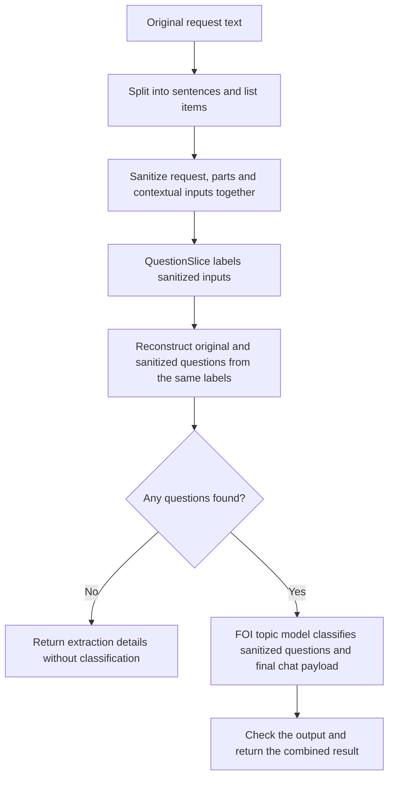

# How the information-request pipeline works

This package turns a piece of correspondence into a list of requests for information, then gives each one a subject and an access regime.

All FOI model inputs first pass through local CPU Presidio sanitization. Extraction results retain original text; see the [sanitization policy and CPU lifecycle](sanitization.md).

Two fine-tuned models do different jobs: **QuestionSlice finds the questions** and **FOI topic model classifies them**. QuestionSlice is built on ModernBERT; FOI topic model is built on Granite. We use these task-specific names throughout this guide; `foi_topic` is the corresponding deployment name in configuration. A “question” can be an instruction such as “Please provide the report”; it does not need a question mark.



## Which fine-tuned models are used?

The model names below are Hugging Face repository IDs. They identify the trained files to load. The Exoscale deployment names are shorter names used by this application to find or start a remote instance.

| Job | Model repository | Exoscale deployment |
|---|---|---|
| Find and group requests for information | `mySociety/question-slice-modernbert-2026-09-08-1` | `question_slice` (when using GPU extraction) |
| Assign access regimes and topics | `mySociety/foi-topic-1b-2026-09-16-1` | `foi_topic` |
| Analyze response status | `mySociety/foi-status-3b-2026-10-12-1` | `foi_status` |

**QuestionSlice** is the fine-tuned ModernBERT classifier trained to assign the four labels described below. CPU and Exoscale extraction use this same checkpoint: CPU runs the whole model, while Exoscale runs its encoder and the API runs its original classification layer. The default local model/tokenizer revision is `eb0436d4be96f113f35b5f891f9cc876a0f0bd6b`. These long revision IDs identify specific versions of the model files.

**FOI topic model**, the merged fine-tuned Granite model, contains both the original model and the changes learned during fine-tuning. It was created from the base model `ibm-granite/granite-4.0-1b` (revision `6a7381ba1f54d684ff508d991aeb7dc580157103`) and the LoRA adapter `mySociety/granite-tiny-foi-topic-grounded-v2` (revision `200b756850c137c255f2e6c5c24474edd894d010`). The merged checkpoint is now published as `mySociety/foi-topic-1b-2026-09-16-1`, the repository used for inference.

Keep the remote import and local model/tokenizer versions aligned when updating either model. For that reason, Exoscale extraction returns `extraction_revision: null` rather than claiming a verified remote revision.

[deployments/catalog.py](../src/llm_management/deployments/catalog.py) defines the typed deployment catalog. [deployments.toml](../conf/deployments.toml) stores shared checkpoint identities, pinned local revisions, local and remote deployments, pipeline bindings, and model limits. [settings.py](../src/llm_management/settings.py) supplies credentials and host environment settings. The `v2` and `grounded-v2` strings are parts of the trained model names, not separate API versions.

## 1. Split the request into manageable parts

[question_slice.py](../src/llm_management/foi/question_slice.py) joins wrapped lines where appropriate, keeps list items together, and splits ordinary prose into sentences. Each part gets a numbered position, starting at zero, so we can record where a question came from.

Before inference, the request, parts and contextual windows are sanitized with one shared placeholder mapping. Original parts remain available for the public result. For each part, we show QuestionSlice the sanitized previous part, current part and next part. This gives it context without asking it to process the whole letter at once. The formatting follows what the model saw during training.

This step returns a `list[SemanticUnit]`. Each `SemanticUnit` contains the part’s `index`, its `text`, and a `kind` of `sentence` or `list_item`. These are positions in the split request, not character offsets.

## 2. Decide what each part is doing

QuestionSlice assigns one of four labels:

| Label | Meaning |
|---|---|
| `QUESTION_START` | Starts a new request for information |
| `QUESTION_CONTINUATION` | Continues an earlier request |
| `ADDITIONAL` | Supporting text kept separately from the questions |
| `IGNORE` | Text left out of the questions, such as a greeting |

We keep the model's probabilities and chosen label. The returned `confidence` is the probability of that label, not a calibrated guarantee that it is correct. List items are classified too: a contextual bullet need not become a question, and several items can be grouped into one question.

[backends.py](../src/llm_management/foi/backends.py) controls where this work happens:

- **CPU**, the default: the whole QuestionSlice model runs in the API process.
- **Exoscale**: the main part of QuestionSlice runs on a remote GPU. It returns numeric representations of the text, and the model's small final classification layer runs locally to produce the labels. This split is needed because the managed gateway exposes embeddings rather than a classification endpoint.

The `backend` choice affects extraction only. FOI topic model runs on Exoscale in both cases.

The label decisions are represented as a `list[UnitPrediction]`. Each `UnitPrediction` contains the original `SemanticUnit`, the chosen `UnitLabel`, its `confidence`, and the probabilities for all four labels. The backend initially returns numeric probability rows; the extraction code validates these and builds the Pydantic objects.

## 3. Assemble the questions

Each start opens a new question; continuations join the most recent question. We build question text from the selected parts and assign IDs such as `q1` and `q2`. We also return additional text and ignored text. Source-part membership is used during reconstruction but is not returned with each question.

There is one recovery rule for this dataset: **if there are no question starts anywhere, but there is a continuation, treat the first continuation as a start**. This can recover a request that the model recognised but labelled incorrectly. It can also combine separate asks, so it is a heuristic rather than a certainty.

If a start exists elsewhere, a continuation before it remains unresolved. The result is marked `uncertain`. If neither starts nor continuations exist, the result is `no_questions_found` and FOI topic model is skipped. Otherwise the result is `questions_found`.

The original labels remain in the response, even after recovery. `promoted_continuation_index` records which part was promoted. Orphan-continuation positions are used internally to determine the extraction status, but are not returned.

The extraction stage returns a `QuestionSliceResult`, which is also the response from `/agents/foi_structure/extract`. Its `questions` field is a list of `ReconstructedQuestion` objects (`ExtractedQuestion` in the established wire schema): each has a `question_id` and reconstructed `text`. The result also includes the extraction status, raw `UnitPrediction` objects, additional/ignored text, recovery details and extraction model information.

## 4. Classify the extracted questions with FOI topic model

[topic_classification.py](../src/llm_management/foi/topic_classification.py) sends the sanitized request and reconstructed sanitized questions to the merged, fine-tuned FOI topic model checkpoint. Its training adapter is already incorporated into the model; no separate adapter is loaded during a request.

For each question, FOI topic model returns:

- An access regime: `FOI` (Freedom of Information), `EIR` (Environmental Information Regulations), or `SAR` (subject access to personal data).
- A short topic describing the subject of the question.

It also returns a list of topics for the request as a whole. For example, “Please provide the latest air pollution monitoring report” might receive `EIR` and a topic such as “Air pollution monitoring”. These are model predictions.

FOI topic model is constrained to return the expected JSON structure. We then check that question IDs match the extracted questions in order, regimes are allowed, topics are nonblank, and request-level topics are unique. Incomplete or invalid output is an error. Classification does not erase an `uncertain` extraction status.

The classification stage returns a `TopicOutput`. Its `questions` field contains `TopicQuestion` objects with a `question_id`, `regime` and `topic`; its `request_topics` field is a list of topic strings for the whole request. `TopicQuestion` does not repeat the source text: use its ID to find the corresponding `ReconstructedQuestion`.

The full pipeline returns an `InformationRequestResult`. This extends `QuestionSliceResult` with the original `request_text`, the `TopicOutput` in `classification`, and `classification_model`. If there are no extracted questions, those last two fields are null. These Pydantic models are defined in [schemas.py](../src/llm_management/foi/schemas.py); over HTTP they are returned as JSON.

## Limits and waiting

Inputs that exceed model limits are rejected rather than silently shortened. QuestionSlice allows 768 tokens per context window. FOI topic model allows a 2,048-token prompt and up to ten questions under the current output-budget rule. Tokens are pieces of text used by models, not necessarily whole words. These limits live in [deployments.toml](../conf/deployments.toml).

Local model work runs outside the async event loop, and remote calls are awaited, so one request waiting for FOI topic model does not block all other requests. CPU classification accepts one in-flight request per model instance; additional calls receive a busy response and should retry. This is not a background batch queue. Remote deployments are created or resumed when needed and use the application's existing idle-scaling lifecycle.

## Prepare both deployments before a batch

For batches using Exoscale extraction, call `POST /deployment-groups/foi_pipeline/ensure` before submitting requests. The `foi_pipeline` group in [deployments.toml](../conf/deployments.toml) contains `question_slice` and `foi_topic`, plus local `presidio`, `question_slice_head_cpu`, and `question_extractor_tokenizer` resources. The endpoint warms local resources and starts or resumes remote deployments concurrently, so their startup waits overlap. It does not run inference or change the order of extraction and classification within a request.

A known group returns HTTP 200 with an overall `success` flag and a `deployments` list containing each member's `slug`, `success`, `replicas` and `error`. Check the flags before starting the batch: one member can fail while another succeeds. Failed members have null `replicas`; successful members have null `error`. Unknown groups return 404. The usual API authentication applies.

Successful deployments are left running if another member fails, and you can retry the group call. Warm-up resets each member's idle timer but does not reserve it indefinitely; normal idle scaling still applies. For CPU extraction, use `POST /deployment-groups/foi_pipeline_cpu/ensure` to warm Presidio, the CPU QuestionSlice classifier, the Granite tokenizer, and the remote topic deployment. Ordinary requests still start deployments on demand if you do not warm them first.

## Where to start reading or calling the code

[pipeline.py](../src/llm_management/foi/pipeline.py) brings these steps together:

- `extract_questions()` runs extraction only.
- `process_information_request()` runs extraction followed by classification.

Both are async functions that can also be called from batch code. They receive access to the application's deployment lookup, startup and activity tracking. The HTTP wrappers in [api/foi.py](../src/llm_management/api/foi.py) expose them as:

- `POST /agents/foi_structure/extract?backend=cpu`
- `POST /agents/foi_structure?backend=cpu`

Both accept `{"request": "Your correspondence here"}`. Use `backend=exoscale` for remote extraction.

[schemas.py](../src/llm_management/foi/schemas.py) defines the results. The full result contains the original request, reconstructed questions, extraction diagnostics and FOI topic model classification. `extraction_model`, `extraction_revision` and `extraction_backend` describe the extraction stage. `classification_model` identifies the merged model used for classification. When no questions are found, `classification` and `classification_model` are both null.

## Response status analysis

`POST /agents/foi_response_analysis` accepts a `request` containing the complete
output of either request endpoint, or just its `questions`, `extraction_status`
and `additional_text`. It also requires a nonempty `sources` list describing
response emails/attachments. Each source has a unique `id`, `kind` (`email` or
`attachment`), `role` (`current`, `prior`, `quoted`), nullable `sender`
(`authority`, `requester`, `other`, `unknown`), nullable `filename`,
`availability` (`visible`, `unavailable`, `unknown`) and nullable `text`.
Visible sources require text; other sources require null text. Sender and
filename keys are required even when null.

```json
{
  "request": {
    "questions": [{"question_id": "q1", "text": "Please provide the report."}],
    "extraction_status": "questions_found",
    "additional_text": []
  },
  "request_text": "Please provide the report.",
  "sources": [{
    "id": "email1",
    "kind": "email",
    "role": "current",
    "sender": "authority",
    "filename": null,
    "availability": "visible",
    "text": "We do not hold this report."
  }]
}
```

The output contract follows the supplied response extraction v4 example:
`outcomes`, `events`, optional nullable `process_states`, and `process_references`.
Question/narrower scopes must reference upstream question IDs; supplied content
must reference provided source IDs with compatible visibility. Whole-request and
unresolved scopes remain available even when no questions were found.
Invalid inputs or prompts exceeding the token budget return 422. Invalid JSON,
truncated completions, unknown question/source references and upstream transport
failures return 502; unavailable configuration or local resources return 503.

The status checkpoint is `mySociety/foi-status-3b-2026-10-12-1`, registered as
`foi_status` and pinned locally at `fde4ea32e68755ef6c08d2bd73cb804c3890b2df`.
The exact published system prompt and output schema are packaged under
[status_contract](../src/llm_management/foi/status_contract/README.md). The model receives a
canonical v4 input serialized with sorted keys and default nulls after sanitization.
Use the trained Granite chat template with thinking disabled and deterministic
JSON generation. The total context is 8,192 tokens, reserving 2,048 for output;
reject prompts over 6,144 tokens without truncating or starting a deployment.

Warm `POST /deployment-groups/foi_response_pipeline/ensure` before a response batch.
It warms `presidio` and `foi_status_tokenizer` and ensures `foi_status`. The tokenizer
is an app-owned local resource that loads no model weights and follows idle expiry.
Remote serving imports by repository name, so its exact weight SHA is not attested.
The checkpoint is a one-epoch integration candidate, not a validated classifier;
its published evaluation identifies weaknesses around acknowledgements, mixed
outcomes and unavailable attachments. Live evaluation is still required.

The trained schema deliberately omits `process_states`: completion and next actor
are outside this task. Public responses retain that enrichment field as null rather
than inventing a value. Refusal, incomplete output and extra generated fields are
errors; the adapter never repairs model JSON.

Contract differences from the request step:

- The training input needs only three request fields. Diagnostics (`ignored_text`,
  `unit_predictions`, extraction provenance and promotion index) and classification
  metadata are accepted in full upstream results but excluded from model input.
- Original request text lives inside the full upstream result, whereas v4 places
  it at the top level. The adapter copies it automatically; an explicit conflicting
  `request_text` is rejected. Extraction-only results require callers to supply
  original text separately if they want that optional context.
- `classification.questions` contains regime/topic metadata, not question text.
  Response analysis uses the top-level reconstructed `questions` array. The v4
  model does not consume topics or regimes or return the request-step diagnostics.
- The existing request schemas do not enforce unique IDs or status/list consistency.
  Response analysis enforces both v4 invariants without changing the request endpoints.
- A response is represented as identified sources, rather than a single raw string.
  Ingestion diagnostics must be converted explicitly to v4 availability values.


## Serving and runtime configuration

Granite serves `mySociety/foi-topic-1b-2026-09-16-1`, containing the
`grounded-v2` adapter merged into Granite 4.0 1B. The merged artifact was inspected
at revision `c2ba6b86e43977bcb71bc90f12dc0cad42ac7e79`; its tokenizer/chat template
is pinned locally to that revision. Exoscale imports weights by repository name,
so keep that import and local tokenizer in sync when updating the model. No base
Granite substitution is allowed. The deployment and local tokenizer must reference the same `[model.<name>]` entry;
update its `repo` and `revision` together to keep them aligned. Model merging and publication are handled in
the fine-tuning project; this service does not require PEFT.

Granite uses JSON-schema constrained generation and validates IDs, counts, regimes,
and unique topics after inference. Inputs over 2,048 chat-template tokens are
rejected before provisioning Granite. Output allowance is `max(256, 64 + 192*n)`,
capped at 2,048 tokens (at most ten questions); exceeding either input or output
budget returns 422 without truncation or automatic chunking. Invalid/incomplete
upstream output returns 502; unavailable deployment/tokenizer returns 503.
This budget remains a heuristic, and smoke tests do not establish accuracy.

Both extraction backends are included in the default Docker image. For a non-Docker
installation, install the inference dependencies in the Python environment running
the API:

```bash
poetry install
```

With Docker, use the normal build and start commands:

```bash
docker compose build
docker compose up
```

Choose CPU or Exoscale per request using the `backend` query parameter; no build-time
mode selection is needed. Both use the same CPU Torch package: CPU mode runs the full
model locally, while Exoscale mode runs only the small classification head locally.
Exoscale-only FOI use does not load the full QuestionSlice CPU encoder.
Poetry locks the inference dependencies together with the API dependencies and
uses the explicit PyTorch CPU package source. The setup was tested on Linux x86_64
with Python 3.11. Mount `CLASSIFIER_CACHE_DIR` on
persistent storage to retain downloaded weights across container replacements.

Example (add the usual bearer header when `AUTH_TOKENS` is configured):

```bash
curl -X POST 'http://localhost:8080/agents/foi_structure/extract?backend=cpu' \
  -H 'Content-Type: application/json' \
  -d '{"request":"Please provide the annual expenditure report."}'
```

Use the same request with `backend=exoscale` for GPU-backed extraction:

```bash
curl -X POST 'http://localhost:8080/agents/foi_structure/extract?backend=exoscale' \
  -H 'Content-Type: application/json' \
  -d '{"request":"Please provide the annual expenditure report."}'
```

This uses the `question_slice` deployment in `conf/deployments.toml`, with the
existing ensure/resume/idle-scaling lifecycle. Exoscale's gateway does not expose
vLLM's native `/classify`, so this backend serves the **fine-tuned encoder** through
`/v1/embeddings` with mean pooling and normalisation disabled, then applies the
**original fine-tuned classification head** locally. This is the same trained model
split across devices, not an unadapted embedding model or a replacement classifier.
Prefix caching must be disabled for this encoder on the tested vLLM 0.29.0 runtime.

GPU probabilities may differ slightly due to float16 execution. Keep the imported
encoder and local head from the same checkpoint release. The local head uses the shared checkpoint’s pinned `revision`;
remote responses use `extraction_revision: null` because the Exoscale importer does not verify
the encoder SHA. Loading the head currently downloads the full safetensors artifact
into the cache, but retains only its small head tensors for inference.

There is no silent backend fallback. Set `QUESTION_SLICE_GPU_ENABLED=false` to
disable remote extraction without provisioning anything.

Optional environment settings:

| Setting | Default | Purpose |
|---|---|---|
| `DEPLOYMENT_CONFIG` | `conf/deployments.toml` | Deployment catalog path |
| `CPU_INFERENCE_THREADS` | `1` | Process-wide PyTorch intra-op thread count |
| `CPU_IDLE_TIMEOUT_MINUTES` | `15` | Unload unused local CPU resources; checked every minute |
| `CLASSIFIER_BATCH_SIZE` | `8` | Maximum semantic units per inference call |
| `CLASSIFIER_MAX_UNITS` | `256` | Maximum semantic units accepted per request |
| `CLASSIFIER_CACHE_DIR` | Hugging Face default | Persistent tokenizer/weight cache location |
| `QUESTION_SLICE_GPU_ENABLED` | `true` | Allow the tested Exoscale encoder + local-head backend |

Model identities and limits are validated by `DeploymentCatalog`. The maximum topic question count is derived from the output
budget. Change limits only to values supported by the trained checkpoint.

A model instance is cached per API worker process. CPU inference runs outside the
async event loop with one in-flight request per model instance. Overload returns
429 with `Retry-After: 1`; batch clients should retry with backoff and limit parallel
requests. This is backpressure, not a durable job queue or cross-request batching.
Requests above 100,000 characters, the configured unit count, or 768 tokens in any
context window are rejected with 422. Inputs are never silently truncated.
Unavailable dependencies/models return 503 and malformed upstream outputs return
502. Avoid multiple API workers until deployment lifecycle ownership is coordinated;
the existing Exoscale cache and idle scaler are process-local.


## Response model identity and provenance

Responses identify extraction with `extraction_model`, `extraction_revision` and
`extraction_backend`. The `backend` query parameter still selects extraction.
`classification_model` identifies the merged checkpoint used for classification,
or is null when classification is skipped. No separate adapter is loaded at runtime.

The merged Granite checkpoint was built from `ibm-granite/granite-4.0-1b`
(revision `6a7381ba1f54d684ff508d991aeb7dc580157103`) and
`mySociety/granite-tiny-foi-topic-grounded-v2`
(revision `200b756850c137c255f2e6c5c24474edd894d010`). These describe training
provenance; they are not independently served models.

## Example: process a batch with async Python

This example runs from an environment with this project installed (for example, `poetry run python batch.py`). Start the API separately, set `LLM_API_URL` to its address, and optionally set `LLM_API_TOKEN` to one of its configured bearer-token values. The token belongs to this API, not Exoscale. The example starts with `list[str]`, warms both remote deployments, then allows up to four requests at a time. Provisioning uses a longer timeout because waking a deployment can take several minutes.

```python
import asyncio
import os

import httpx2

from llm_management.foi.schemas import InformationRequestResult


async def process_batch(
    requests: list[str], *, concurrency: int = 4
) -> list[InformationRequestResult | BaseException]:
    if concurrency < 1:
        raise ValueError("concurrency must be at least 1")
    if not requests:
        return []

    token = os.getenv("LLM_API_TOKEN")
    headers = {"Authorization": f"Bearer {token}"} if token else {}
    async with httpx2.AsyncClient(
        base_url=os.getenv("LLM_API_URL", "http://localhost:5000"),
        headers=headers,
        timeout=httpx2.Timeout(180.0, connect=10.0),
    ) as client:
        warmup = await client.post(
            "/deployment-groups/foi_pipeline/ensure",
            timeout=httpx2.Timeout(900.0, connect=10.0),
        )
        warmup.raise_for_status()
        readiness = warmup.json()
        # HTTP 200 can still contain individual deployment failures.
        if not readiness["success"]:
            failed = [m for m in readiness["deployments"] if not m["success"]]
            raise RuntimeError(f"Deployment warm-up failed: {failed}")

        slots = asyncio.Semaphore(concurrency)

        async def process_one(text: str) -> InformationRequestResult:
            async with slots:
                response = await client.post(
                    "/agents/foi_structure",
                    params={"backend": "exoscale"},
                    json={"request": text},
                )
                response.raise_for_status()
                return InformationRequestResult.model_validate(response.json())

        # Wait for every item; keep individual errors alongside successful results.
        return await asyncio.gather(
            *(process_one(text) for text in requests), return_exceptions=True
        )


async def main() -> None:
    requests: list[str] = [
        "Please provide the latest air pollution monitoring report.",
        "Please provide the number of FOI requests received last year.",
        "Thank you for your response.",
    ]
    results = await process_batch(requests)
    for index, result in enumerate(results):
        if isinstance(result, BaseException):
            print(f"Request {index} failed: {result}")
            continue
        print(f"Request {index}: {result.extraction_status}")
        if result.classification is not None:
            for question in result.classification.questions:
                print(question.question_id, question.regime, question.topic)


if __name__ == "__main__":
    asyncio.run(main())
```

Results stay in the same order as the input strings, even when requests finish in a different order. The semaphore limits active HTTP requests; the remaining tasks wait in this client process. This is an in-memory batch, not a durable queue. The example collects per-request errors without automatic retries, so successful requests can be retained while failed ones are inspected or retried. A successful HTTP response may still have an extraction status of `uncertain` or `no_questions_found`.

The group call ensures remote deployments are running and warms Presidio, the local classification head, and the Granite tokenizer. The QuestionSlice tokenizer still loads on its first extraction request; group warm-up does not run inference. Individual resources can also be warmed through `/deployments/{slug}/ensure`, as described in the [main README](sanitization.md). Deployments follow normal idle scaling after the batch. The example does not scale them down explicitly because other clients may be using them.

## Example: process a batch with Ruby

This version uses Ruby's standard `net/http`, `json` and thread libraries, so no extra gems or Python installation are needed. Use the same `LLM_API_URL` and optional `LLM_API_TOKEN` environment variables as above, then run `ruby batch.rb`. A fixed pool of worker threads processes an `Array<String>` from a queue, allowing HTTP requests to overlap while limiting concurrency. Each HTTP request has its own connection, so workers do not share a `Net::HTTP` session.

```ruby
require "net/http"
require "json"
require "uri"
require "thread"


def post_json(path, body: nil, read_timeout: 180)
  base_url = ENV.fetch("LLM_API_URL", "http://localhost:5000")
  uri = URI("#{base_url.sub(%r{/+$}, '')}#{path}")
  request = Net::HTTP::Post.new(uri)
  request["Accept"] = "application/json"
  token = ENV["LLM_API_TOKEN"]
  request["Authorization"] = "Bearer #{token}" if token && !token.empty?
  unless body.nil?
    request["Content-Type"] = "application/json"
    request.body = JSON.generate(body)
  end

  response = Net::HTTP.start(
    uri.host, uri.port,
    use_ssl: uri.scheme == "https",
    open_timeout: 10,
    read_timeout: read_timeout,
    write_timeout: 30
  ) { |http| http.request(request) }

  unless response.is_a?(Net::HTTPSuccess)
    raise "HTTP #{response.code} from #{uri.path}"
  end
  JSON.parse(response.body)
end


def process_batch(requests, concurrency: 4)
  unless concurrency.is_a?(Integer) && concurrency.positive?
    raise ArgumentError, "concurrency must be a positive integer"
  end
  return [] if requests.empty?

  readiness = post_json("/deployment-groups/foi_pipeline/ensure", read_timeout: 900)
  unless readiness.fetch("success")
    failed = readiness.fetch("deployments").reject { |member| member.fetch("success") }
    raise "Deployment warm-up failed: #{failed.inspect}"
  end

  queue = Queue.new
  requests.each_with_index { |text, index| queue << [index, text] }
  worker_count = [concurrency, requests.length].min
  worker_count.times { queue << nil } # One stop marker per worker.
  results = Array.new(requests.length)
  result_lock = Mutex.new

  workers = Array.new(worker_count) do
    Thread.new do
      while (item = queue.pop)
        index, text = item
        result = begin
          post_json("/agents/foi_structure?backend=exoscale", body: { request: text })
        rescue StandardError => error
          error # Keep this item's failure and continue with the queue.
        end
        result_lock.synchronize { results[index] = result }
      end
    end
  end
  workers.each(&:value) # Wait for all workers; surface unexpected worker errors.
  results
end


if $PROGRAM_NAME == __FILE__
  requests = [
    "Please provide the latest air pollution monitoring report.",
    "Please provide the number of FOI requests received last year.",
  ]

  process_batch(requests).each_with_index do |result, index|
    if result.is_a?(StandardError)
      warn "Request #{index} failed: #{result.message}"
      next
    end
    puts "Request #{index}: #{result.fetch('extraction_status')}"
    classification = result["classification"]
    next if classification.nil?

    classification.fetch("questions").each do |question|
      puts [question.fetch("question_id"), question.fetch("regime"), question.fetch("topic")].join(" | ")
    end
  end
end
```

As in the Python example, results retain input order and individual failures do not discard successful results. Warm-up failure stops the batch before inference is submitted. Successful responses are parsed Ruby hashes with string keys, rather than Pydantic objects; this example relies on the API's response validation and does not perform equivalent client-side schema validation. The queue is in memory, there are no automatic retries, and normal deployment idle scaling still applies.

### Status validation

Local tests in `tests/test_foi_status.py` exercise the exact prompt, sanitization,
context admission, real SDK transport with mocked responses, completion checks,
reference validation and lifecycle activity. Live semantic examples are in
`tests/test_foi_status_external.py`; run them explicitly:

```sh
poetry run pytest -m external tests/test_foi_status_external.py -q
```

These tests may provision the configured Exoscale GPU deployment. They check
supplied, not-held, withheld, pending and acknowledgement examples, and may fail
on this candidate even when transport and schema validation succeed.

## Mock endpoints for integration testing

These routes accept the same request bodies, backend query parameter (where
applicable), and bearer authentication as the real routes:

- `POST /mock/agents/foi_structure/extract?backend=cpu`
- `POST /mock/agents/foi_structure?backend=cpu`
- `POST /mock/agents/foi_response_analysis`

Each call selects a random bundled validation example. The mocks do not inspect
request meaning, load model weights, or start GPU deployments; `backend=exoscale`
is accepted without contacting Exoscale. Request extraction and classification
use the gold results from the same selected R1–R5 example. The full result's
`request_text` is that example's text, rather than the submitted text.

Mock extraction diagnostics (`ignored_text`, `unit_predictions`) are empty and
`extraction_revision` is null. Model fields contain `mock:validation-examples`
to distinguish these responses from inference. These diagnostics are mock
placeholders, not dataset gold labels or observed model predictions.

Response analysis returns an unchanged S1–S5 gold output, including its original
question and source IDs. Those IDs may not exist in the submitted input. Use these
routes to exercise response handling and UI integration; use the real endpoints
when checking whether results correspond to the submitted correspondence.

The [validation examples](foi-live-validation-examples.md) document all payloads,
expected results, dataset revisions and source checksums. The same typed bundled
examples drive the mocks and live tests. For paid validation using stable test
names, run:

```sh
SERVER_ROLE=test poetry run pytest -m external -v \
  tests/test_question_slice_external.py \
  tests/test_foi_pipeline_external.py \
  tests/test_foi_status_external.py \
  --junitxml=foi-validation-results.xml -o junit_family=xunit1
```

The live tests accept original gold extraction/classification outputs or explicit
reviewed alternatives in `accepted_extractions` and `accepted_classifications`.
Each alternative includes a review reason and observation provenance; the original
dataset fields remain unchanged. Response-analysis items must match completely.
Outcome/event order does not matter, but missing, extra or duplicate items fail.
Pipeline tests check extraction before topic classification, require exact question
IDs/order and regimes, and accept topic wording only when the complete output
matches gold or a reviewed alternative. Unrecognised wording still fails for review.
JUnit properties record exact gold matches and reviewed matches for extraction and
topics, plus case, endpoint/backend, status, latency and complete actual output (including model
provenance where the API returns it). Test failures distinguish transport errors,
schema validation errors, whitespace-only extraction differences and other
semantic mismatches. These are dataset expectations, not claims of live accuracy.
