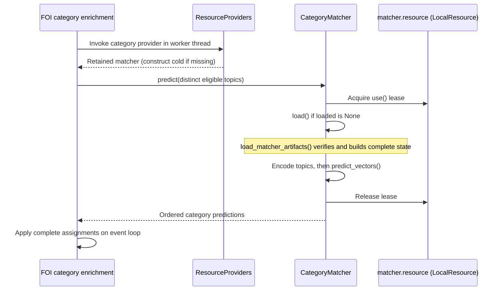

# Resource types and registration

A **resource type** describes how to construct and manage a local model resource.
A **deployment instance** supplies its concrete configuration. A **feature role**
selects which instance a pipeline uses. Adding a checkpoint, adding a loading
approach and adding an inference stage are different changes.

This guide covers local resources, and shows where remote deployments and hosted
APIs fit. See [application architecture](architecture.md) for HTTP dependencies,
application ownership and the definitions of owner, guard, provider and lease.

## Choose the smallest change

| What is changing? | What to change |
| --- | --- |
| Another checkpoint or limit supported by an existing loader | Add/change a deployment instance and its checkpoint in configuration; bind it to the intended feature role. Verify the loader's label, artifact and input/output contracts still match. |
| A new loading approach, artifact format, or controller contract | Add a local schema, cold factory/owner, and one registration, as described below. |
| When inference runs, how inputs are prepared, or how predictions are interpreted | Change the owning feature's pipeline and contracts. Registration does not encode stage order, thresholds or fallback policy. |
| A pure rule with no retained model state or loading lifecycle | Add a normal feature function; it does not need resource registration. |
| Another remotely served model using an existing managed/Compute backend | Add its remote deployment configuration and feature binding; local registration is only needed for any local companion resource. |
| Another hosted model using a supported API service | Add an API deployment and feature binding. These models have no application-managed compute warm-up or idle unloading. |
| A new cloud lifecycle or API transport implementation | Extend the deployment backend or API service integration, respectively. Local resource registration does not replace those interfaces. |

A common inference method is not enough to make checkpoints interchangeable. For
example, QuestionSlice validates its trained labels, and SAR/automatic factories
set different output labels and loading options. Reuse a resource type only when
its complete contract fits the new instance.

## Type, instance and role

The category matcher provides a concrete example:

| Concept | Example | Meaning |
| --- | --- | --- |
| Registered type | `resource_types.CATEGORY_MATCHER` | Associates `CategoryMatcherDeployment`, its factory, and the `CategoryMatcher` owner. |
| Loader tag | `loader = "foi_category_matcher"` | Selects that type when validating a local deployment entry. |
| Deployment instance | `slug = "foi_categories_cpu"` | Names one configured instance, with index/encoder references and a trusted checksum. |
| Checkpoints | `[model.foi_categories]`, `[model.foi_category_encoder]` | Store repository identities and pinned revisions. |
| Feature role | `[foi].category_matcher = "foi_categories_cpu"` | Chooses the instance used for FOI enrichment. |
| Warm-up membership | The slug in a deployment group's `deployments` list | Chooses what an explicit group warm-up prepares; it does not order inference. |
| Runtime owner | One `CategoryMatcher` per slug per application | Retains that instance's model state and exposes `predict()`. |

One registration can serve several independently configured slugs. Within one
application, consumers of the same slug share its owner and guard. Different
slugs have different owners, even when their checkpoint references match. A
separate application also gets separate owners for the same slugs.

## How the existing local types fit

All local factories receive `(config, *, catalog, registry)` and construct a cold
owner. There are only two owner shapes: a controller exposing a `.resource`
guard, or a `LocalResource` returned directly. There is no common `predict()`
interface: each feature retains the concrete inference API it needs.

| Registration | Owner | What it retains / useful pattern to copy |
| --- | --- | --- |
| `QUESTION_CLASSIFIER` | `LocalSequenceClassifier` | Full QuestionSlice weights and tokenizer, with trained label/input validation. |
| `SAR_CLASSIFIER`, `AUTOMATIC_CLASSIFIER` | `AuthenticatedSequenceClassifier` | Shared execution class, separate schemas and factories for feature-specific labels/settings. |
| `SAR_LOGISTIC` | `sar.resources.LogisticDetector` | A pinned logistic artifact and its feature validation. |
| `AUTOMATIC_LOGISTIC` | `automatic.resources.LogisticDetector` | Related cascade/standalone policies with shared weights under one guard. |
| `CATEGORY_MATCHER` | `CategoryMatcher` | Encoder, tokenizer, verified index and scoring matrices with one shared lifetime. |
| `QUESTION_HEAD` | `ModernBertClassificationHead` | Local classifier head used with a remote encoder; the feature explicitly coordinates both. |
| `TOPIC_TOKENIZER`, `RESPONSE_TOKENIZER` | `LocalResource` directly | A small callback-owned cache; no separate controller is needed. Schemas distinguish the two roles despite their shared owner class. |
| `PRESIDIO` | `PresidioSanitizer` | A local analyzer configured by spaCy model and threshold rather than a Hub checkpoint. |

Choose the resource boundary by **shared state and lifetime**. The category index
and encoder are useful together, so one owner loads and unloads them together.
Use separate resources when components need independent reuse or warm-up/unload
lifetimes. The feature still coordinates their inference; registration does not
build a dependency graph or execute a pipeline.

Remote resources have a different boundary. `deployments/config.py` describes
managed/Compute deployments, whose backend controllers provision and stop remote
compute through `DeploymentService`. `deployments/api_config.py` describes hosted
model/search services. Neither becomes a `LocalResource` just to obtain a uniform
interface. Deployment groups may combine local and managed/Compute resources;
API deployments are excluded from those groups.

## Register a new local approach

### 1. Define its configuration contract

Add a schema in
[`deployments/local_config.py`](../src/llm_management/deployments/local_config.py).
Use `LocalModelDeployment` for a standard `model_ref`, or `LocalDeployment` when
there is no checkpoint reference. Add one unique `loader: Literal["..."]` and
validate the loader's own settings using Pydantic fields/validators.

The schema must remain data-only. Feature role validation and cross-resource
relationships belong in the named checks in `deployments/catalog_validation.py`,
called by `DeploymentCatalog.validate_references()`.
The catalog already checks standard `model_ref` references; additional reference
fields, like the matcher's `encoder_ref`, need their own reference validation.

### 2. Implement the owner and cold factory

Keep these in the feature package, or shared inference code when reusable. The
factory accepts the schema, catalog and application registry and returns either:

- A controller with a `.resource` guard. Copy `CategoryMatcher` for compound model
  state or the SAR logistic owner for a single artifact.
- A `LocalResource` with load/unload callbacks retaining their cache. Copy a
  tokenizer factory for this smaller shape.

Constructors only retain configuration and register their guard under `config.slug`.
Loads may download verified artifacts and allocate model state; unload callbacks
clear that state. Hold `resource.use()` through loading and inference. The guard
manages readiness and leases but does not cache the load callback's return value.

Model-specific labels, artifact integrity, safe deserialization and output shape
checks belong with the loader/owner. The factory must return the concrete owner
class declared in the registration. Existing convenience functions may return a
broader protocol; register a concrete construction factory directly. A class with
the required constructor signature can itself be the factory, as with both logistic
detectors. Construction requires explicit configuration, catalog and registry;
it never chooses the default application. The SAR, Automatic and QuestionSlice
convenience accessors take no arguments and only retrieve a default application's
retained owner. Use the constructor or `create_*` factory for isolated resources.

### 3. Declare the registration beside its lazy binding

In [`deployments/resource_types.py`](../src/llm_management/deployments/resource_types.py),
add the schema import and the owner's annotation under `TYPE_CHECKING`, then add
a lazy binding function and a named declaration before the final `RESOURCE_TYPES`
index. The category matcher is the complete pattern:

```python
def category_matcher_binding() -> ResourceBinding[
    CategoryMatcherDeployment, CategoryMatcher
]:
    """
    Resolve the factory and concrete owner class without loading model artifacts.
    """
    from ..foi.category_classification import CategoryMatcher, category_matcher

    return ResourceBinding(factory=category_matcher, owner_type=CategoryMatcher)


CATEGORY_MATCHER = _register_resource_type(
    CategoryMatcherDeployment, category_matcher_binding
)
```

Adapt the schema, factory and owner for the new approach. `ResourceBinding` is a
named record; the binding function defers its runtime imports. `CATEGORY_MATCHER`
is an ordinary immutable `ResourceType` value. `_register_resource_type()` records
it and rejects duplicate loader tags without invoking the binding. This private
helper builds the closed application table during module import; it is not a
runtime plugin API.

Nothing else needs to list the type: catalog validation, serialization, JSON
schema and factory lookup derive from those declarations. The owner type also
flows through the generic registration into provider return types.

### 4. Configure instances and bind feature roles

Add the deployment instance, pinned checkpoint identities and limits to
`conf/deployments.toml`. Configure the feature's role to select its slug and add
warm-up group membership when appropriate. None of these choices belongs in the
Python registration.

In the feature's dependency composition, obtain a typed provider:

```python
matcher_provider = providers.provider(
    resource_types.CATEGORY_MATCHER,
    lambda: catalog.require_foi().category_matcher,
)
```

This has type `Callable[[], CategoryMatcher]`. The registration is a type choice;
the callable supplies the configured instance choice. Deferring that lookup lets
management-only applications assemble without requiring every feature's config.
On use, the provider validates the selected schema before constructing an owner.

For a new FOI role, add its injectable provider field and binding together in
`FOIResources.from_config()` in `foi/backends.py`. A new feature requires application
composition; a new resource for the existing FOI feature does not require another
entry in `bootstrap.py`. Keep selection, input preparation, inference order,
response schemas and failure behavior explicit in the feature's pipeline.

### 5. Verify the boundaries

The existing tests in `test_resource_registration.py` cover cold registration,
configured factories, typed providers, concurrency, schema mismatches and shared
lifecycle ownership. Extend model-specific tests to verify the new loader's
artifact contract, inference/output behavior, unloading and reload. Use fake
artifacts/providers in local tests and mark real network/compute tests external.

For a new resource, confirm catalog loading and application assembly leave its
owner unconstructed; constructing the owner must still leave its model unloaded.
Warm-up and inference must resolve the same owner. Check that unused feature
paths do not resolve it and that exceptions preserve the feature's failure policy.

The usual integration touches four areas: **schema**, **owner/factory**,
**registration declaration**, and **deployment configuration**. New feature roles
also require **feature configuration/validation and composition**; inference
semantics require **feature code and tests**. There is no additional manual schema
union, string import table, slug helper or provider owner-type table to maintain.

## Follow the category example at runtime



`CategoryMatcher.load()` handles the cache transition and error translation under
its lease. `load_matcher_artifacts()` performs the expensive downloads, integrity
checks and model construction, returning a `LoadedCategoryMatcher` only when all
steps succeed. `predict_vectors()` ranks categories and applies the separate
centroid threshold for abstention. `classify_categories()` owns the feature policy:
exclude SAR questions, deduplicate topics, and leave categories null if inference
fails.

| Moment | Controller | `matcher.loaded` |
| --- | --- | --- |
| Application assembled | Not constructed yet | No matcher yet |
| Provider first invoked | Constructed and retained | `None` |
| Warm-up or first prediction succeeds | Same controller | Complete model/index state |
| Idle resource unloaded | Same controller retained | `None` |
| Later prediction | Same controller reused | Loaded again under its lease |

Explicit warm-up reaches the same matcher through
`ResourceRegistry.get(slug).warmup()`, which invokes its `load()` callback. Idle
cleanup invokes `unload()` only after the guard excludes active inference. Neither
operation runs the feature's question-selection or result-assignment logic.
